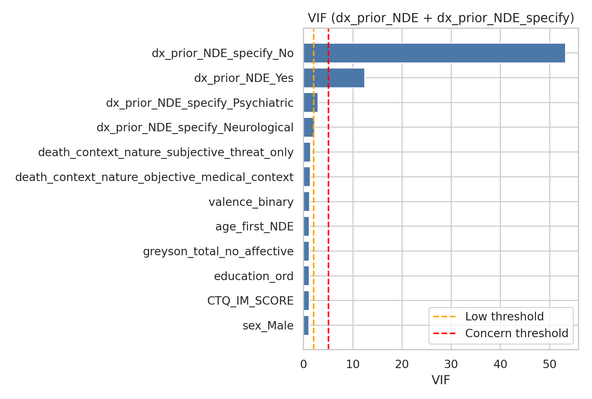
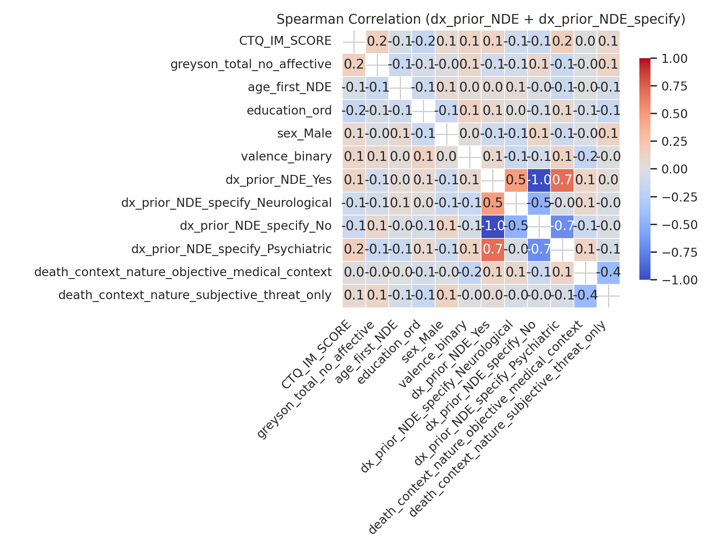
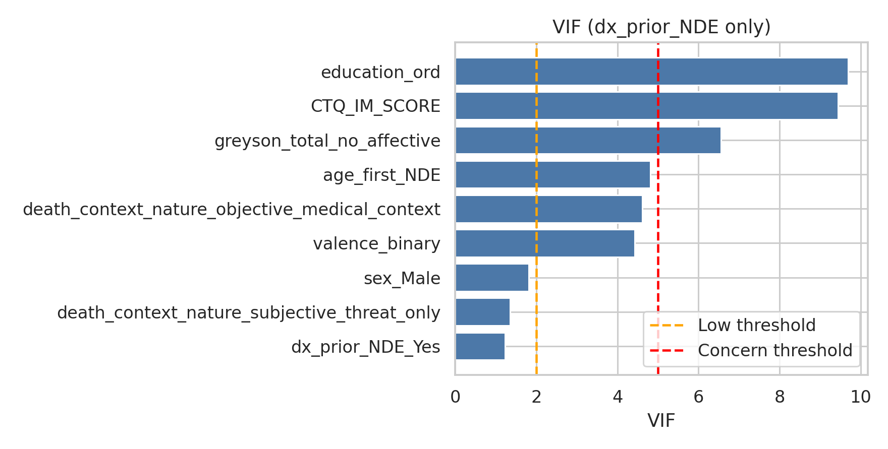
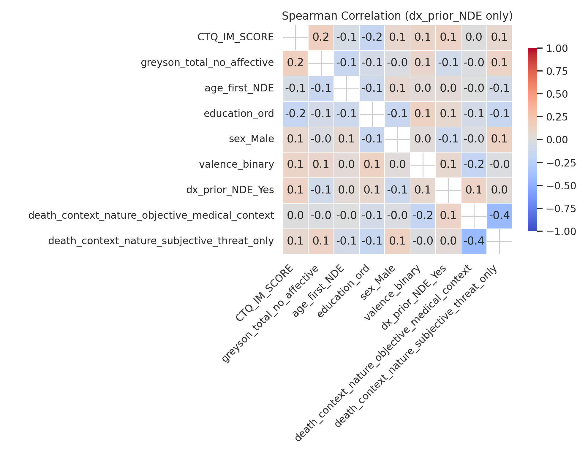
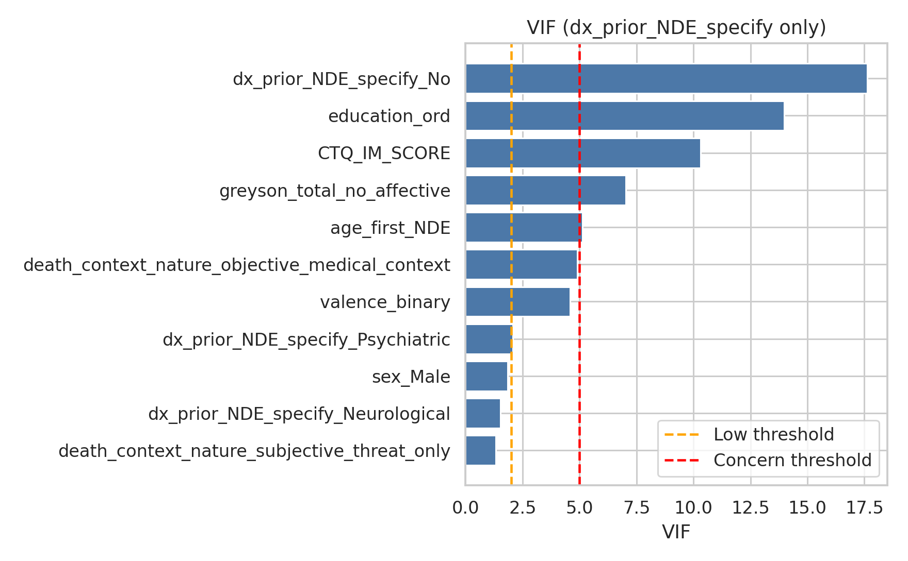
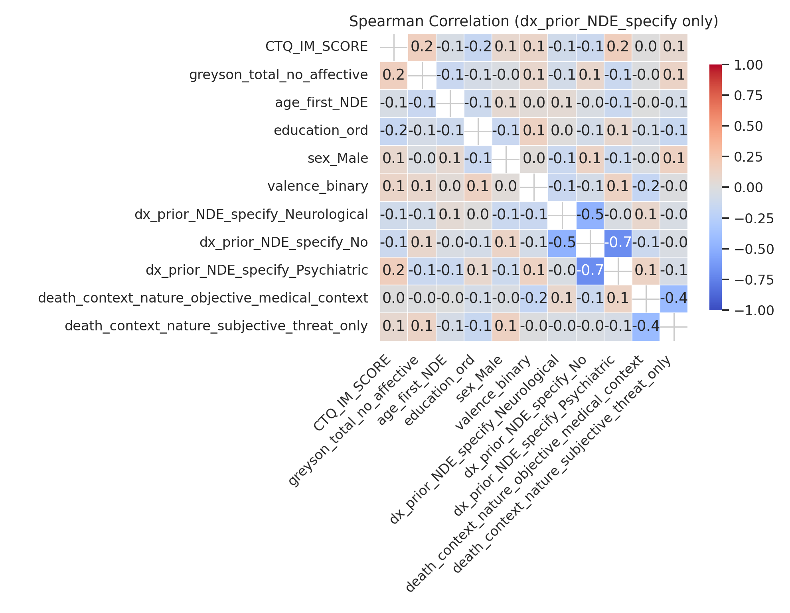

# Collinearity-Only Report (3 dx versions)

This report embeds the VIF and Spearman diagnostics for each requested specification.

Primary publication specification is `v2_dx_prior_only`; `v1_dx_joint` and `v3_dx_specify_only` are retained as structural/sensitivity diagnostics.


## v1_dx_joint — dx_prior_NDE + dx_prior_NDE_specify

- Rows used for diagnostics: 122
- Predictors in design matrix: 12

### VIF Table

```
                                     predictor    vif collinearity
                       dx_prior_NDE_specify_No 53.272         High
                              dx_prior_NDE_Yes 12.428         High
              dx_prior_NDE_specify_Psychiatric  2.936     Moderate
             dx_prior_NDE_specify_Neurological  2.212     Moderate
   death_context_nature_subjective_threat_only  1.420          Low
death_context_nature_objective_medical_context  1.358          Low
                                valence_binary  1.170          Low
                                 age_first_NDE  1.167          Low
                    greyson_total_no_affective  1.160          Low
                                 education_ord  1.152          Low
                                  CTQ_IM_SCORE  1.114          Low
                                      sex_Male  1.072          Low
```

### VIF Figure



### Spearman Correlation Table

```
                                     predictor  CTQ_IM_SCORE  greyson_total_no_affective  age_first_NDE  education_ord  sex_Male  valence_binary  dx_prior_NDE_Yes  dx_prior_NDE_specify_Neurological  dx_prior_NDE_specify_No  dx_prior_NDE_specify_Psychiatric  death_context_nature_objective_medical_context  death_context_nature_subjective_threat_only
                                  CTQ_IM_SCORE         1.000                       0.159         -0.050         -0.163     0.079           0.110             0.126                             -0.101                   -0.126                             0.168                                           0.005                                        0.074
                    greyson_total_no_affective         0.159                       1.000         -0.147         -0.067    -0.030           0.088            -0.092                             -0.081                    0.092                            -0.135                                          -0.015                                        0.123
                                 age_first_NDE        -0.050                      -0.147          1.000         -0.123     0.069           0.039             0.034                              0.052                   -0.034                            -0.134                                          -0.004                                       -0.067
                                 education_ord        -0.163                      -0.067         -0.123          1.000    -0.141           0.148             0.071                              0.013                   -0.071                             0.079                                          -0.077                                       -0.149
                                      sex_Male         0.079                      -0.030          0.069         -0.141     1.000           0.024            -0.118                             -0.137                    0.118                            -0.119                                          -0.030                                        0.144
                                valence_binary         0.110                       0.088          0.039          0.148     0.024           1.000             0.072                             -0.146                   -0.072                             0.136                                          -0.177                                       -0.013
                              dx_prior_NDE_Yes         0.126                      -0.092          0.034          0.071    -0.118           0.072             1.000                              0.481                   -1.000                             0.689                                           0.130                                        0.037
             dx_prior_NDE_specify_Neurological        -0.101                      -0.081          0.052          0.013    -0.137          -0.146             0.481                              1.000                   -0.481                            -0.036                                           0.093                                       -0.039
                       dx_prior_NDE_specify_No        -0.126                       0.092         -0.034         -0.071     0.118          -0.072            -1.000                             -0.481                    1.000                            -0.689                                          -0.130                                       -0.037
              dx_prior_NDE_specify_Psychiatric         0.168                      -0.135         -0.134          0.079    -0.119           0.136             0.689                             -0.036                   -0.689                             1.000                                           0.133                                       -0.056
death_context_nature_objective_medical_context         0.005                      -0.015         -0.004         -0.077    -0.030          -0.177             0.130                              0.093                   -0.130                             0.133                                           1.000                                       -0.423
   death_context_nature_subjective_threat_only         0.074                       0.123         -0.067         -0.149     0.144          -0.013             0.037                             -0.039                   -0.037                            -0.056                                          -0.423                                        1.000
```

### Spearman Heatmap




## v2_dx_prior_only — dx_prior_NDE only

- Rows used for diagnostics: 122
- Predictors in design matrix: 9

### VIF Table

```
                                     predictor   vif collinearity
                                 education_ord 9.699         High
                                  CTQ_IM_SCORE 9.440         High
                    greyson_total_no_affective 6.552         High
                                 age_first_NDE 4.819     Moderate
death_context_nature_objective_medical_context 4.619     Moderate
                                valence_binary 4.427     Moderate
                                      sex_Male 1.808          Low
   death_context_nature_subjective_threat_only 1.346          Low
                              dx_prior_NDE_Yes 1.224          Low
```

### VIF Figure



### Spearman Correlation Table

```
                                     predictor  CTQ_IM_SCORE  greyson_total_no_affective  age_first_NDE  education_ord  sex_Male  valence_binary  dx_prior_NDE_Yes  death_context_nature_objective_medical_context  death_context_nature_subjective_threat_only
                                  CTQ_IM_SCORE         1.000                       0.159         -0.050         -0.163     0.079           0.110             0.126                                           0.005                                        0.074
                    greyson_total_no_affective         0.159                       1.000         -0.147         -0.067    -0.030           0.088            -0.092                                          -0.015                                        0.123
                                 age_first_NDE        -0.050                      -0.147          1.000         -0.123     0.069           0.039             0.034                                          -0.004                                       -0.067
                                 education_ord        -0.163                      -0.067         -0.123          1.000    -0.141           0.148             0.071                                          -0.077                                       -0.149
                                      sex_Male         0.079                      -0.030          0.069         -0.141     1.000           0.024            -0.118                                          -0.030                                        0.144
                                valence_binary         0.110                       0.088          0.039          0.148     0.024           1.000             0.072                                          -0.177                                       -0.013
                              dx_prior_NDE_Yes         0.126                      -0.092          0.034          0.071    -0.118           0.072             1.000                                           0.130                                        0.037
death_context_nature_objective_medical_context         0.005                      -0.015         -0.004         -0.077    -0.030          -0.177             0.130                                           1.000                                       -0.423
   death_context_nature_subjective_threat_only         0.074                       0.123         -0.067         -0.149     0.144          -0.013             0.037                                          -0.423                                        1.000
```

### Spearman Heatmap




## v3_dx_specify_only — dx_prior_NDE_specify only

- Rows used for diagnostics: 122
- Predictors in design matrix: 11

### VIF Table

```
                                     predictor    vif collinearity
                       dx_prior_NDE_specify_No 17.638         High
                                 education_ord 13.978         High
                                  CTQ_IM_SCORE 10.323         High
                    greyson_total_no_affective  7.024         High
                                 age_first_NDE  5.135         High
death_context_nature_objective_medical_context  4.904     Moderate
                                valence_binary  4.581     Moderate
              dx_prior_NDE_specify_Psychiatric  2.072     Moderate
                                      sex_Male  1.838          Low
             dx_prior_NDE_specify_Neurological  1.528          Low
   death_context_nature_subjective_threat_only  1.319          Low
```

### VIF Figure



### Spearman Correlation Table

```
                                     predictor  CTQ_IM_SCORE  greyson_total_no_affective  age_first_NDE  education_ord  sex_Male  valence_binary  dx_prior_NDE_specify_Neurological  dx_prior_NDE_specify_No  dx_prior_NDE_specify_Psychiatric  death_context_nature_objective_medical_context  death_context_nature_subjective_threat_only
                                  CTQ_IM_SCORE         1.000                       0.159         -0.050         -0.163     0.079           0.110                             -0.101                   -0.126                             0.168                                           0.005                                        0.074
                    greyson_total_no_affective         0.159                       1.000         -0.147         -0.067    -0.030           0.088                             -0.081                    0.092                            -0.135                                          -0.015                                        0.123
                                 age_first_NDE        -0.050                      -0.147          1.000         -0.123     0.069           0.039                              0.052                   -0.034                            -0.134                                          -0.004                                       -0.067
                                 education_ord        -0.163                      -0.067         -0.123          1.000    -0.141           0.148                              0.013                   -0.071                             0.079                                          -0.077                                       -0.149
                                      sex_Male         0.079                      -0.030          0.069         -0.141     1.000           0.024                             -0.137                    0.118                            -0.119                                          -0.030                                        0.144
                                valence_binary         0.110                       0.088          0.039          0.148     0.024           1.000                             -0.146                   -0.072                             0.136                                          -0.177                                       -0.013
             dx_prior_NDE_specify_Neurological        -0.101                      -0.081          0.052          0.013    -0.137          -0.146                              1.000                   -0.481                            -0.036                                           0.093                                       -0.039
                       dx_prior_NDE_specify_No        -0.126                       0.092         -0.034         -0.071     0.118          -0.072                             -0.481                    1.000                            -0.689                                          -0.130                                       -0.037
              dx_prior_NDE_specify_Psychiatric         0.168                      -0.135         -0.134          0.079    -0.119           0.136                             -0.036                   -0.689                             1.000                                           0.133                                       -0.056
death_context_nature_objective_medical_context         0.005                      -0.015         -0.004         -0.077    -0.030          -0.177                              0.093                   -0.130                             0.133                                           1.000                                       -0.423
   death_context_nature_subjective_threat_only         0.074                       0.123         -0.067         -0.149     0.144          -0.013                             -0.039                   -0.037                            -0.056                                          -0.423                                        1.000
```

### Spearman Heatmap



