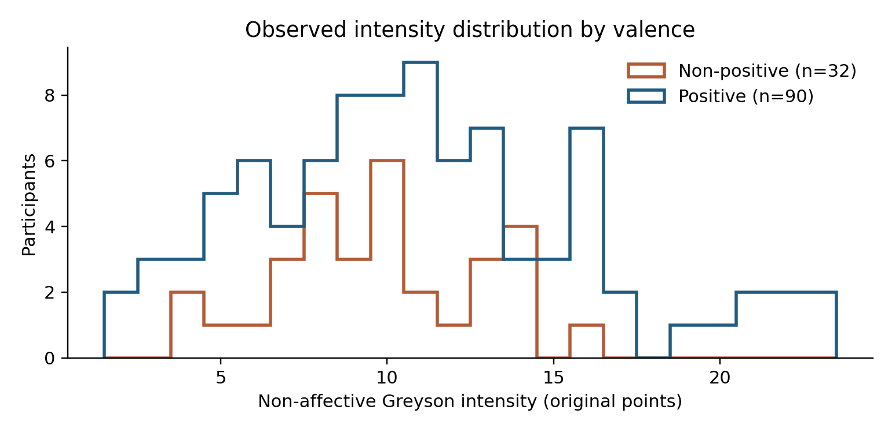
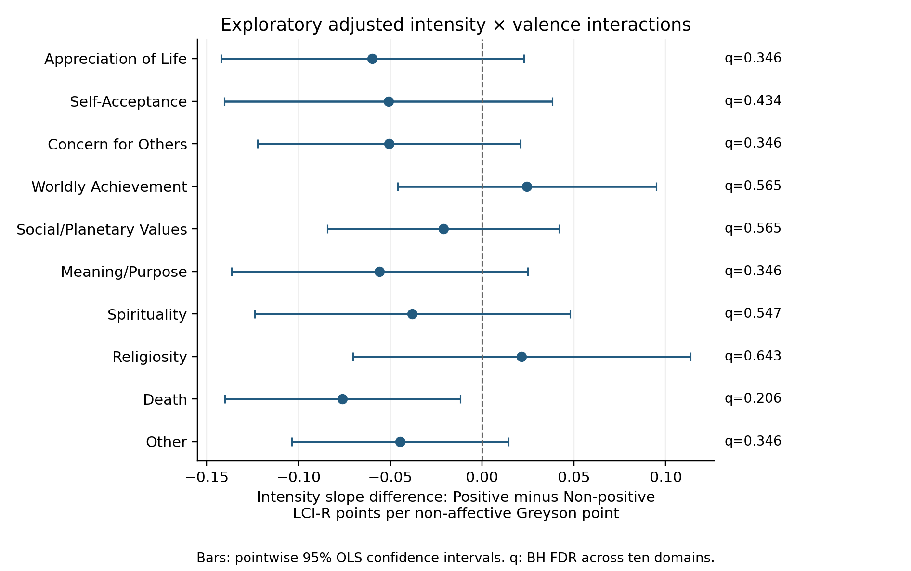
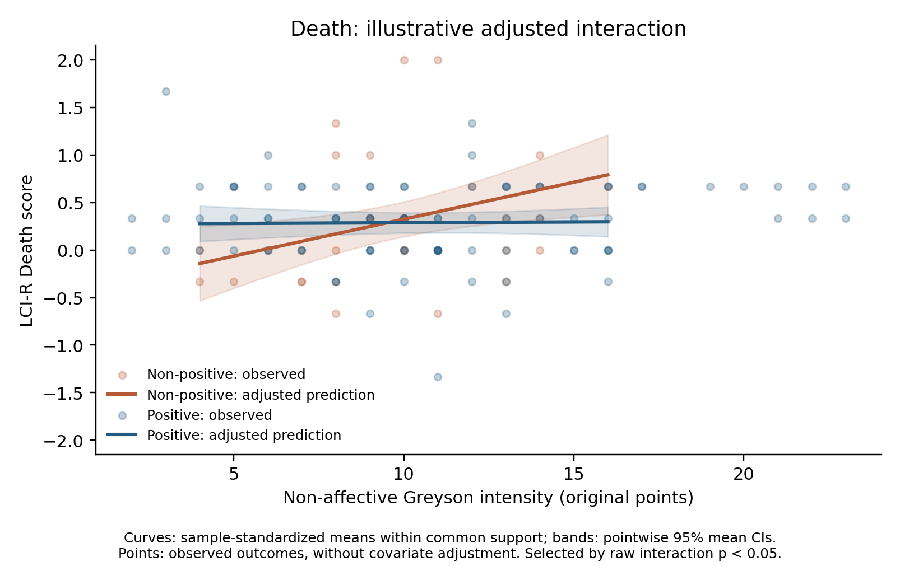

# Exploratory intensity × valence interaction analysis

## 1. Research question

Does the association between continuous non-affective Greyson intensity and each of ten LCI-R domain scores differ between Positive and Non-positive experiences? The reviewer is asking about moderation, which an additive model cannot test. This exploration informs a later team decision; it does not revise the manuscript or its primary analysis.

## 2. Data and feasibility

The local input has 122 rows; existing preprocessing retains 122 after `TO_DROP` and valid-valence filtering (0 excluded). There are 90 Positive and 32 Non-positive participants. Non-positive consists of 28 Mixed and 4 Negative experiences (87.5% Mixed). Intensity below is in original score points.

| Group | N | Mean (SD) | Median [Q1, Q3] | Range | Within common range |
| --- | --- | --- | --- | --- | --- |
| Non-positive | 32 | 9.75 (3.08) | 10.00 [8.00, 12.25] | 4–16 | 32/32 |
| Positive | 90 | 10.89 (4.99) | 10.50 [7.25, 13.75] | 2–23 | 75/90 |

The common observed intensity range is 4–16, with 12 exact intensity values represented in both groups. 15 positive participants lie outside the non-positive range. Range overlap does not guarantee comparable covariate combinations or equally dense observations throughout that range.

| Original valence | N | Mean (SD) | Range |
| --- | --- | --- | --- |
| Mixed | 28 | 9.96 (3.19) | 4–16 |
| Negative | 4 | 8.25 (1.71) | 6–10 |
| Positive | 90 | 10.89 (4.99) | 2–23 |



| Domain | N (+ / non+) | Missing outcome | Missing predictors | Complete-case exclusions | Status |
| --- | --- | --- | --- | --- | --- |
| Appreciation of Life | 122 (90 / 32) | 0 | 0 | 0 | ok |
| Self-Acceptance | 122 (90 / 32) | 0 | 0 | 0 | ok |
| Concern for Others | 122 (90 / 32) | 0 | 0 | 0 | ok |
| Worldly Achievement | 122 (90 / 32) | 0 | 0 | 0 | ok |
| Social/Planetary Values | 122 (90 / 32) | 0 | 0 | 0 | ok |
| Meaning/Purpose | 122 (90 / 32) | 0 | 0 | 0 | ok |
| Spirituality | 122 (90 / 32) | 0 | 0 | 0 | ok |
| Religiosity | 122 (90 / 32) | 0 | 0 | 0 | ok |
| Death | 122 (90 / 32) | 0 | 0 | 0 | ok |
| Other | 122 (90 / 32) | 0 | 0 | 0 | ok |

There are 0 missing item responses among 6100 LCI-R item cells, involving 0 participants. Domain eligibility uses the existing threshold (at least half the items, rounded up); available eligible items are averaged. Missing domain scores and covariates are then handled by complete cases per domain, without imputation. Item missingness need not imply a missing domain. All 10 fitted interaction designs are full rank; total single-deletion rank failures: 0.

## 3. Methods

Existing `preprocess_data`, `LCI_SECTIONS`, `LCI_MAP`, education coding, and death-context dummy construction are reused unchanged. LCI-R item responses map from −2 (Strongly diminished) to +2 (Strongly increased); each domain is an unweighted mean. The ten domains include exploratory **Other**. The internal `Material Achievements` domain is displayed as **Worldly Achievement**, matching current reports. There is no intensity split or additional outcome recoding.

The intensity variable is **`greyson_total_no_affective`**. Existing preprocessing z-scores it; this analysis takes the same score from `analysis_pretransform_df` to express the coefficient per original Greyson point. Its eligible-cohort mean, **10.590164**, is subtracted before fitting. This centering uses the entire preprocessed eligible cohort and stays fixed across domains and sensitivity models. The provided CSV does not include the original Greyson items, so the upstream construction of this supplied non-affective score cannot be independently re-audited here.

Let I be centered intensity, V=1 for Positive and V=0 for Mixed/Negative (Non-positive, the reference). For each domain Y, fit OLS:

- Baseline: `Y ~ I + V + age_first_NDE + CTQ_IM_SCORE + education_ord + dx_prior_NDE_Yes + sex_Male + death-context dummies`.
- Interaction: the same predictors plus `I:V`.

These preserve exactly the current adjusted specification: age at first NDE (already standardized by existing preprocessing), CTQ minimization/denial score (`CTQ_IM_SCORE`), ordinal education, prior diagnosis indicator, sex indicator and the existing death-context dummies. Education is coded 0=Other/no formal education, 1=primary, 2=secondary, 3=college/university, 4=graduate or higher. Diagnosis is Yes=1, otherwise 0; sex is Male=1, otherwise 0. The dummies are `death_context_nature_objective_medical_context, death_context_nature_subjective_threat_only`; the observed reference is `no_death_context`. The intensity main effect is included once. Other continuous/ordinal covariates, including the diagnosis indicator, are mean-centered just as in the current adjusted fitter; sex and death-context dummies retain their existing coding. The existing minimum model N is 30.

The interaction coefficient β is the Positive slope **minus** the Non-positive slope per one original Greyson point. A negative β indicates a less positive (or more negative) slope in Positive experiences. The intensity main coefficient is the slope for Non-positive experiences; adding β gives the Positive slope. The valence coefficient is the adjusted group difference at mean intensity. The intercept describes Non-positive participants at centered covariate values, sex_Male=0 and the reference death context. These conditional terms are not a replacement for the original additive main-effect analysis.

The primary test is a two-sided OLS t test of β=0, with residual degrees of freedom and a pointwise 95% CI. It is checked against the one-degree-of-freedom nested F test. **BH FDR corrects the ten interaction p-values together**; q<0.05 is the reporting threshold. ΔR² is interaction-model minus baseline ordinary R² on identical observations; it is in-sample improvement, not validated predictive gain. CIs are not adjusted for multiplicity.

Focused sensitivity checks include HC3 heteroskedasticity-robust intervals and t tests on the same fitted coefficients, plus an unadjusted interaction fit on the *same adjusted-model sample*. Each sensitivity's ten p-values form a separate BH family; they do not enlarge or replace the prespecified primary family. Influence screening uses Cook's D>4/N, leverage>2k/N (k includes the intercept), and |interaction DFBETAS|>2/√N as descriptive flags, followed by one-case-at-a-time refits. No observations are removed from the reported estimates, and deletion p-values are diagnostic, not independent hypothesis tests.

Baseline validation: **PASS**, 210 numerical comparisons, maximum absolute difference **8.83e-12**. `baseline_validation.csv` compares all numeric fields reproduced by the existing adjusted fitter against `outputs/latest/main/tables/lci_adjusted_full_models.csv`, then checks baseline N, R², intercept, valence coefficient/p, AIC and BIC after the raw-intensity reparameterization. Differences within 1e-8 absolute/relative tolerance are numerical rounding or library arithmetic, not a specification discrepancy. Baseline and interaction row indices are asserted identical for every model, and the unadjusted sensitivity receives those same rows.

## 4. Results

| Domain | β interaction [95% CI] | p | q (BH) | R² baseline | R² interaction | ΔR² |
| --- | --- | --- | --- | --- | --- | --- |
| Appreciation of Life | -0.0598 [-0.1422, 0.0227] | 0.1535 | 0.3463 | 0.2456 | 0.2594 | 0.0138 |
| Self-Acceptance | -0.0510 [-0.1404, 0.0383] | 0.2603 | 0.4339 | 0.2146 | 0.2235 | 0.0090 |
| Concern for Others | -0.0507 [-0.1223, 0.0209] | 0.1631 | 0.3463 | 0.2496 | 0.2627 | 0.0131 |
| Worldly Achievement | 0.0244 [-0.0460, 0.0949] | 0.4933 | 0.5649 | 0.1928 | 0.1962 | 0.0034 |
| Social/Planetary Values | -0.0211 [-0.0842, 0.0420] | 0.5084 | 0.5649 | 0.0791 | 0.0827 | 0.0036 |
| Meaning/Purpose | -0.0558 [-0.1365, 0.0249] | 0.1731 | 0.3463 | 0.2692 | 0.2814 | 0.0122 |
| Spirituality | -0.0380 [-0.1239, 0.0479] | 0.3826 | 0.5465 | 0.2261 | 0.2314 | 0.0053 |
| Religiosity | 0.0216 [-0.0704, 0.1135] | 0.6430 | 0.6430 | 0.1214 | 0.1231 | 0.0017 |
| Death | -0.0761 [-0.1402, -0.0119] | 0.0206 | 0.2062 | 0.0476 | 0.0927 | 0.0451 |
| Other | -0.0447 [-0.1038, 0.0144] | 0.1368 | 0.3463 | 0.2326 | 0.2479 | 0.0152 |

For **Death**, the slope difference is -0.0761 LCI-R points per Greyson point (95% CI -0.1402 to -0.0119; p=0.0206, q=0.2062). The non-positive slope is 0.0776 [0.0175, 0.1378], and the positive slope is 0.0016 [-0.0206, 0.0238]. These are descriptive slopes within the interaction model, not new primary main-effect tests. R² rises from 0.0476 to 0.0927: ΔR²=0.0451, or 4.51 percentage points. HC3 gives p=0.0212, q=0.2116. Deleting each observation in turn yields β from -0.0905 to -0.0660 and raw p from 0.0066 to 0.0465; there are 0 sign reversals. The unadjusted estimate on the same sample is -0.0582 (p=0.0628, q=0.6279). In the other 9 domains, raw p ranges from 0.1368 to 0.6430, and ΔR² ranges from 0.0017 to 0.0152.



Illustrative prediction plots are generated only for domains with raw interaction p<0.05. This selection is descriptive, not evidence of FDR significance. Curves average the model over the same observed covariate distribution for both groups, are restricted to the common observed intensity range, and use pointwise confidence intervals for the estimated mean (not individual prediction intervals). Faint points are unadjusted observations. The CSV stores the plotted predictions.



### Focused robustness checks

| Domain | HC3 p | HC3 q | Cook flags | Max \|DFBETAS\| | Deletion β range | Deletion p range | Sign flips |
| --- | --- | --- | --- | --- | --- | --- | --- |
| Appreciation of Life | 0.2338 | 0.4580 | 8 | 0.581 | [-0.0835, -0.0384] | [0.0505, 0.3681] | 0 |
| Self-Acceptance | 0.2748 | 0.4580 | 10 | 0.468 | [-0.0702, -0.0301] | [0.1285, 0.5156] | 0 |
| Concern for Others | 0.1657 | 0.4580 | 7 | 0.494 | [-0.0684, -0.0379] | [0.0667, 0.2942] | 0 |
| Worldly Achievement | 0.5301 | 0.5890 | 10 | 0.722 | [-0.0009, 0.0354] | [0.3256, 0.9811] | 1 |
| Social/Planetary Values | 0.5040 | 0.5890 | 5 | 0.375 | [-0.0330, -0.0109] | [0.3116, 0.7357] | 0 |
| Meaning/Purpose | 0.2036 | 0.4580 | 8 | 0.514 | [-0.0765, -0.0414] | [0.0683, 0.3419] | 0 |
| Spirituality | 0.3226 | 0.4609 | 4 | 0.340 | [-0.0527, -0.0252] | [0.2369, 0.5752] | 0 |
| Religiosity | 0.7284 | 0.7284 | 8 | 0.888 | [-0.0188, 0.0424] | [0.3688, 0.9180] | 2 |
| Death | 0.0212 | 0.2116 | 10 | 0.452 | [-0.0905, -0.0660] | [0.0066, 0.0465] | 0 |
| Other | 0.1179 | 0.4580 | 6 | 0.451 | [-0.0580, -0.0379] | [0.0601, 0.2099] | 0 |

Cook flags concern overall model influence; interaction DFBETAS and deletion ranges specifically assess the moderation estimate. `influence_diagnostics.csv` records each diagnostic by input data row (one-based, excluding the header), without copying response identifiers. Flagged cases remain in all reported fits.

Across the adjusted designs, there are 11 fitted parameters including the intercept, with 111 residual degrees of freedom. The condition number is 46.46; maximum leverage is 0.243. Cook-flag counts range from 4 to 10. Worldly Achievement and Religiosity show 1 and 2 deletion sign reversals, respectively; their intervals already span zero. These flags identify sensitivity, not grounds for automatic exclusion.

| Domain | Unadjusted β [95% CI] | p | q (separate family) | ΔR² |
| --- | --- | --- | --- | --- |
| Appreciation of Life | -0.0491 [-0.1320, 0.0337] | 0.2424 | 0.6747 | 0.0101 |
| Self-Acceptance | -0.0366 [-0.1234, 0.0502] | 0.4059 | 0.6747 | 0.0050 |
| Concern for Others | -0.0479 [-0.1180, 0.0222] | 0.1785 | 0.6747 | 0.0127 |
| Worldly Achievement | 0.0283 [-0.0411, 0.0977] | 0.4208 | 0.6747 | 0.0050 |
| Social/Planetary Values | -0.0057 [-0.0661, 0.0547] | 0.8519 | 0.8519 | 0.0003 |
| Meaning/Purpose | -0.0252 [-0.1064, 0.0560] | 0.5397 | 0.6747 | 0.0027 |
| Spirituality | -0.0160 [-0.1007, 0.0687] | 0.7086 | 0.7873 | 0.0010 |
| Religiosity | 0.0333 [-0.0573, 0.1239] | 0.4685 | 0.6747 | 0.0044 |
| Death | -0.0582 [-0.1195, 0.0032] | 0.0628 | 0.6279 | 0.0287 |
| Other | -0.0205 [-0.0788, 0.0378] | 0.4879 | 0.6747 | 0.0035 |

## 5. Interpretation

0 of ten adjusted interactions meet BH q<0.05 (smallest q=0.2062). The estimates therefore provide no multiplicity-adjusted evidence that the intensity association differs by binary valence in this dataset. This does not demonstrate equal slopes or equivalence: the interaction intervals remain compatible with potentially meaningful differences. The nominal Death finding warrants a cautious description, rather than a claim of established moderation. These tests address moderation; they do not re-establish the manuscript's comparison of the relative importance of intensity and valence. No causal interpretation is supported.

## 6. Limitations

Group sizes are 90:32 (ratio 2.81:1), and intensity variability is lower in Non-positive experiences (SD 3.08 versus 4.99). The slope difference is consequently less precisely informed by that group. Non-positive is 87.5% Mixed, with only 4 Negative cases; the analysis cannot establish moderation specific to clearly negative experiences. There is no Non-positive support beyond its 4–16 range, and the 15 Positive observations outside common support still contribute to the full-sample linear fit.

Adjusted interaction CI widths span 0.1182–0.1839 LCI-R points per intensity point. No equivalence margin was specified or tested. Domain averages are bounded [−2, 2]; OLS assumes a linear conditional mean and independent observations. HC3 addresses sensitivity of standard errors to heteroskedasticity, not nonlinear mean structure, selection bias or unmeasured confounding. Marginal range overlap does not establish joint covariate overlap. The ten domains are measured in the same people and are correlated; BH is applied as requested, without claiming arbitrary-dependence guarantees. **Other** remains exploratory, and all interaction analyses were prompted after the original analysis. Item scoring and exclusions inherit the existing preprocessing, including its indicator handling; original covariates have no missing values in this input. No external or out-of-sample validation is performed.

## 7. Decision considerations

Arguments for reporting: the analysis directly addresses the reviewer's moderation question, reproduces the additive baseline to 8.83e-12 maximum absolute difference, and adds only one prespecified term per domain on matched samples. Reporting all ten estimates, intervals, q-values and ΔR² would expose both the nominal Death pattern and the precision limits, without changing the original primary analysis.

Arguments for restraint: only 32 participants inform the Non-positive slope, 28 of whom are Mixed; no adjusted interaction survives correction across ten domains. The nominal finding is selected from a post-review exploratory family, and the interaction intervals do not establish equivalence. The influence and unadjusted tables quantify sensitivity and should accompany any selected example. ΔR² is an in-sample statistic and cannot establish predictive or clinical usefulness.

These are decision considerations for the research team, not an automatic recommendation to add the analysis. No manuscript edits or reviewer response were produced.

Reproduction from the repository root:

```bash
../../.venv/bin/python scripts/run_intensity_valence_interaction.py
../../.venv/bin/python -m pytest tests/test_intensity_valence_interaction.py -q
```

All generated files are confined to `outputs/exploratory/intensity_valence_interaction/` by default. `run_manifest.json` records input/config/source hashes, base commit, package versions and protection checks. Repeated-run equality is checked separately in `reproducibility_check.json`. Existing tracked files and all `outputs/latest/main/` contents are fingerprinted before and after execution; changed protected files trigger an error. The main CLI is never invoked.

Implementation references: [statsmodels OLS/HC3](https://www.statsmodels.org/stable/generated/statsmodels.regression.linear_model.OLSResults.html), [influence diagnostics](https://www.statsmodels.org/stable/generated/statsmodels.stats.outliers_influence.OLSInfluence.html), and [multiple testing](https://www.statsmodels.org/stable/generated/statsmodels.stats.multitest.multipletests.html). These describe the implementation; all numerical conclusions above come from the local data.
