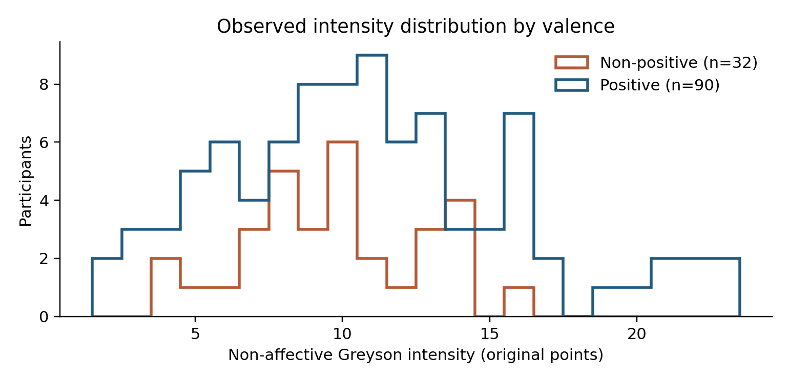
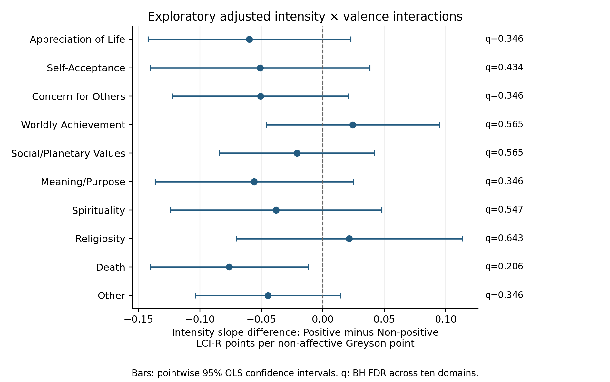
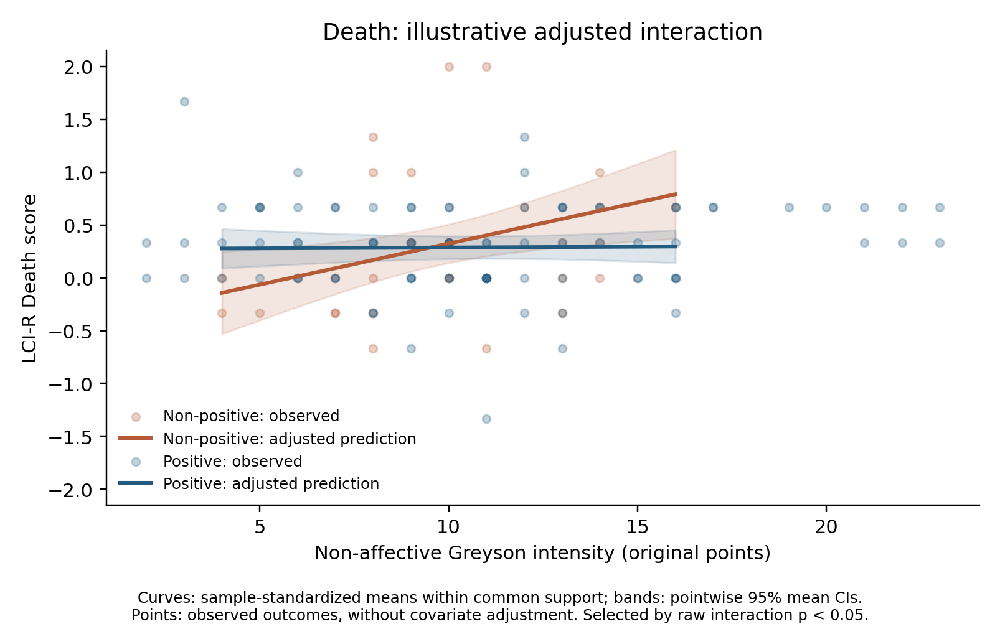

# Does emotional valence modify the association between NDE intensity and life changes?

## 1. Research question

Reviewer 2 asked: “Did the authors consider testing interactions between intensity and valence? Why not?” This exploratory analysis asks whether the association between near-death experience (NDE) intensity and subsequent life changes differs between Positive and Non-positive experiences. Original models assumed a common intensity slope.

## 2. Data and analytical approach

The sample comprised 122 participants: 90 Positive and 32 Non-positive, including 28 Mixed and four Negative experiences. Intensity was measured continuously using the non-affective Greyson score, centered at its sample mean. Outcomes were ten Life Changes Inventory–Revised (LCI-R) domains, including exploratory Other. Scores range from −2 (strongly diminished) to +2 (strongly increased).

For each domain, adjusted linear regression models with and without the interaction were compared using the same participants. The interaction allows different intensity slopes; the comparison assesses improvement in model fit. Original covariates were retained: age at first NDE, sex, education, prior diagnosis, Childhood Trauma Questionnaire minimization/denial score, and death context. Benjamini–Hochberg false discovery rate (FDR) correction covered all ten interaction tests, using q<0.05.

**Figure 1. Available intensity values.** Blue represents Positive and orange Non-positive experiences; height indicates participant counts, not percentages. Ranges are 4–16 for Non-positive and 2–23 for Positive experiences. Fewer Non-positive observations and narrower coverage limit slope precision.

## 3. Main results

The interaction coefficient β is the **Positive minus Non-positive intensity slope**, in LCI-R points per Greyson point. Confidence intervals are pointwise 95% intervals, without multiple-comparison adjustment. ΔR² measures the added explained variance.

| Domain | β | 95% confidence interval | p-value | FDR q-value | ΔR² |
| --- | --- | --- | --- | --- | --- |
| Appreciation of Life | −0.0598 | [−0.1422, 0.0227] | 0.1535 | 0.3463 | 0.0138 |
| Self-Acceptance | −0.0510 | [−0.1404, 0.0383] | 0.2603 | 0.4339 | 0.0090 |
| Concern for Others | −0.0507 | [−0.1223, 0.0209] | 0.1631 | 0.3463 | 0.0131 |
| Worldly Achievement | 0.0244 | [−0.0460, 0.0949] | 0.4933 | 0.5649 | 0.0034 |
| Social/Planetary Values | −0.0211 | [−0.0842, 0.0420] | 0.5084 | 0.5649 | 0.0036 |
| Meaning/Purpose | −0.0558 | [−0.1365, 0.0249] | 0.1731 | 0.3463 | 0.0122 |
| Spirituality | −0.0380 | [−0.1239, 0.0479] | 0.3826 | 0.5465 | 0.0053 |
| Religiosity | 0.0216 | [−0.0704, 0.1135] | 0.6430 | 0.6430 | 0.0017 |
| Death | −0.0761 | [−0.1402, −0.0119] | 0.0206 | 0.2062 | 0.0451 |
| Other | −0.0447 | [−0.1038, 0.0144] | 0.1368 | 0.3463 | 0.0152 |

**None of the ten interactions survived FDR correction.** Death alone showed a nominal interaction (p<0.05 before correction): intensity was more positively associated with its score in Non-positive experiences. This does not establish robust moderation after correction.

Additional explanatory value was limited: ΔR² ranged from 0.0017 to 0.0152 outside Death. These are improvements within this sample, not validated predictive performance.

**Figure 2. Differences between intensity slopes.** Each dot estimates the group difference; its bar shows uncertainty. Zero indicates equal slopes. Negative values indicate a more positive slope in Non-positive experiences. Only Death’s interval excludes zero, but the displayed q-values show that no domain passes FDR correction.

**Figure 3. Illustrating the nominal Death finding.** Faint points are observed scores. Lines are adjusted model predictions, averaging over the same covariate distribution; shaded bands are 95% confidence intervals for the mean, not individual outcomes. The orange Non-positive line rises more steeply than the blue Positive line. Predictions stop at the shared intensity range. This illustration does not establish an FDR-significant interaction.

## 4. Interpretation and limitations

These results do not establish moderation that would qualify the manuscript’s conclusion of stronger associations with intensity than valence. However, testing whether slopes differ addresses a different question from comparing predictors’ relative importance and does not independently confirm that conclusion.

Nonsignificant interactions do not establish identical slopes or equivalence. Precision is limited by group imbalance, intensity coverage and the predominance of Mixed experiences. Four Negative experiences cannot establish a distinct relationship for clearly negative NDEs.

Death’s nominal finding was similar with HC3 robust standard errors (p=0.0212), but weaker without covariate adjustment (p=0.0628). The post-review exploratory setting and multiple comparisons limit confirmatory interpretation. The associations do not establish causality.

## 5. Implications for the manuscript

**Option A:** Briefly report the exploration in Results, acknowledge limitations in Discussion. This exposes evidence and uncertainty but adds complexity. **Option B:** Present the analysis and limitations in the reviewer response without adding them to the main manuscript. This preserves focus but reduces readers’ access to the exploration.
