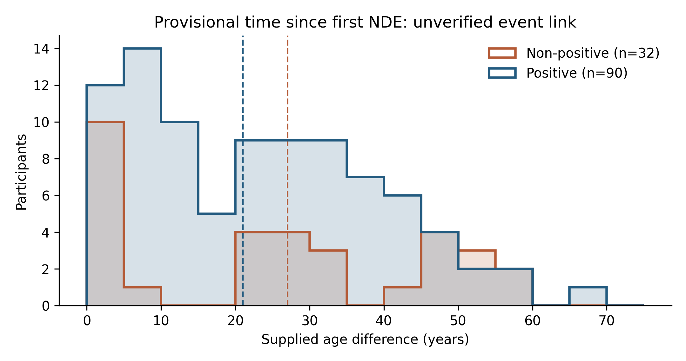
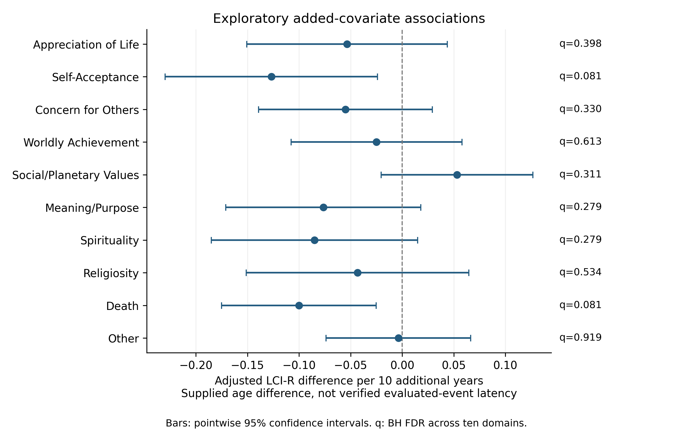
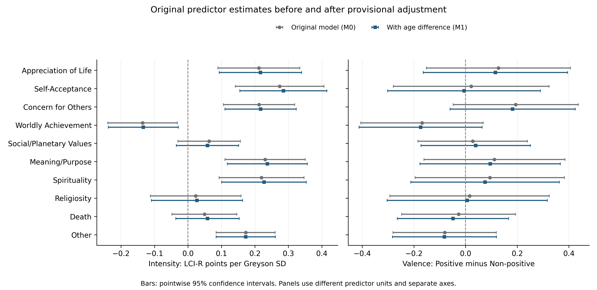

# Exploratory first-NDE latency covariate analysis: technical report

## Scope and definition status

Reviewer 2 asked whether time since the NDE should be included as a covariate. This independent exploration starts from local `main` at `58307634aff3788b3b8165483edefc8a8f8dbd06` on `analysis/nde-latency-covariate`; it does not import or merge the intensity × valence analysis. No manuscript or reviewer response is edited.

**The temporal definition is unverified.** The supplied task describes `age` as current age and `age_first_NDE` as age at first NDE. The two CSVs contain no questionnaire wording, completion dates, event-selection rule or data dictionary that independently establishes these meanings. The user explicitly confirmed that these definitions cannot be verified. File modification times do not establish survey dates. Numerical consistency therefore supports subtraction, but does not validate event timing.

The operational variable `latency_first_NDE_proxy` is **supplied age minus supplied age_first_NDE**, in years. It is interpreted conditionally as time since the first NDE only if those supplied definitions are correct. It must not be described as verified time since the specifically evaluated NDE.

## 1. Sources, merging and age validation before modeling

Sources: `/home/prejaas/Public/Questionaries/DATA/data_for_model.csv` and `/home/prejaas/Public/Questionaries/DATA/data_age.csv`. Identifiers are read consistently as strings and joined exactly, without fuzzy matching, whitespace normalization or numerical ID conversion. A one-to-one left join preserves the original cohort, its ordering and all original preprocessing eligibility rules.

There are 122 modeling rows and 122 age-file rows. Both files have 0 and 0 missing IDs, respectively, and 0 and 0 duplicate-ID rows. Matches: **122**; unmatched modeling participants: **0**; age-file-only participants: **0**. No participants are silently removed or imputed.

| Field | N | Range | Missing | Nonnumeric | Nonfinite | Negative | >100 review | >120 verify | Fractional |
| --- | --- | --- | --- | --- | --- | --- | --- | --- | --- |
| age_first_NDE | 122 | 10–79 | 0 | 0 | 0 | 0 | 0 | 0 | 0 |
| age | 122 | 22–94 | 0 | 0 | 0 | 0 | 0 | 0 | 0 |

Age screening precedes subtraction and fitting. Negative or nonfinite/nonnumeric ages, ages >120, or a negative age difference halt modeling pending review. Ages >100 and supplied current ages <18 are explicit review flags, not new automatic exclusions; these are operational screens, not biological or questionnaire eligibility claims. Observed ages trigger none of these flags. Zero age at first NDE would not automatically be rejected. Supplied first-NDE age exceeds current age in **0** cases. There are **0** negative differences and **5** zero differences. The latter are retained: whole-year age recording cannot distinguish same-year events precisely.

`age_validation.csv` and `merge_diagnostics.csv` contain aggregate checks only. No participant identifiers, per-person age pairs, row indices or model residual records are exported into the repository.

## 2. Multiple NDEs and documentary limitations

The available local CSV headers, main README, preprocessing, covariate code and local presentation notes were inspected. Neither modeling data nor the age file includes an NDE count/indicator, selected-event age/date, survey completion date, or a rule selecting the first versus most significant event. `dx_prior_NDE` is prior diagnosis history and is not an NDE count. Consequently, whether participants could report multiple NDEs, how often that happened, and which event they evaluated remain unknown. No single-NDE classification or restricted sensitivity sample is invented. The non-affective Greyson score also arrives as an upstream score rather than original items.

The age audit establishes numerical plausibility, not verified definitions. All fitted models below are **conditional analyses of the supplied age difference**, not definitive control for elapsed time since the evaluated experience.

## 3. Descriptive findings

| Group | N | Mean (SD) | Median [Q1, Q3] | Range | Zero |
| --- | --- | --- | --- | --- | --- |
| All eligible | 122 | 23.25 (16.93) | 23.00 [8.00, 36.00] | 0–66 | 5 |
| Non-positive | 32 | 25.31 (19.71) | 27.00 [3.00, 46.00] | 0–59 | 2 |
| Positive | 90 | 22.51 (15.89) | 21.00 [8.00, 34.00] | 0–66 | 3 |
| Original valence: Mixed | 28 | 26.07 (19.46) | 27.00 [3.75, 46.00] | 0–59 | 1 |
| Original valence: Negative | 4 | 20.00 (23.72) | 15.00 [1.50, 33.50] | 0–50 | 1 |
| Original valence: Positive | 90 | 22.51 (15.89) | 21.00 [8.00, 34.00] | 0–66 | 3 |

Overall skewness is 0.376; the upper 1.5-IQR screening fence is 78.0 years, and 0 observations fall outside the two fences. The maximum difference is 66 years. The modest skew and absence of this simple extreme-value flag do not justify an automatic transformation. No log transformation, trimming or winsorization is applied. Linearity remains an assumption, not a validated property.

| Variables | N | Pearson r | Spearman ρ |
| --- | --- | --- | --- |
| age_at_survey / age_first_NDE_raw | 122 | 0.3875 | 0.3331 |
| age_at_survey / latency_first_NDE_proxy | 122 | 0.3890 | 0.3656 |
| age_at_survey / intensity_raw | 122 | -0.0075 | 0.0381 |
| age_first_NDE_raw / latency_first_NDE_proxy | 122 | -0.6986 | -0.7039 |
| age_first_NDE_raw / intensity_raw | 122 | -0.1673 | -0.1474 |
| latency_first_NDE_proxy / intensity_raw | 122 | 0.1613 | 0.1461 |

Intensity–difference associations are described continuously by correlation, without dichotomizing intensity. Correlations are descriptive and no new hypothesis-testing family is introduced. The exact identity is `age = age_first_NDE + latency_first_NDE_proxy` for every complete pair; arithmetic equality is tested, not a claim of event-definition validity.



Bars show counts in five-year intervals (the groups have unequal sample sizes); dashed lines are group medians. Zero differences remain represented.

## 4. Models and encoding

Existing `preprocess_data`, LCI-R item maps, domain definitions and eligibility threshold are reused unchanged. Item responses range −2 to +2; each domain averages available items if at least half are valid (rounded up). Complete cases are selected once per domain across all M1 predictors and the outcome; exactly those rows enter M0, M1 and M2. There is no imputation. The minimum model N remains 30.

- **M0:** the original additive adjusted model: non-affective Greyson intensity, valence, age at first NDE, CTQ minimization/denial, ordinal education, prior diagnosis, sex and death-context dummies.
- **M1:** M0 plus centered `latency_first_NDE_proxy` in years; age at first NDE is retained.
- **M2:** M1 with age at survey instead of age at first NDE. This is an algebraic reparameterization, not a sensitivity test or independent evidence.

Positive=1 and Mixed/Negative=0, with Non-positive the reference. Sex is Male=1, otherwise 0; diagnosis is Yes=1, otherwise 0. Education is 0=Other/no formal education, 1=primary, 2=secondary, 3=college/university, 4=graduate/higher. Death-context reference is `no_death_context`; indicators are `objective_medical_context` and `subjective_threat_only`. **Other** is exploratory, and internal Material Achievements is displayed as **Worldly Achievement**.

The main preprocessing standardizes intensity and first-NDE age using eligible-cohort means and population SDs; their original standardized values are retained in M0 and M1. Other continuous/ordinal terms, including the diagnosis indicator, are centered as in the existing fitter. The proxy and current age are centered at their eligible-cohort means. Intensity coefficients therefore represent LCI-R points per one eligible-cohort SD of Greyson intensity, valence coefficients Positive minus Non-positive adjusted differences, and the M1 proxy coefficient LCI-R points per additional year at fixed first-NDE age and other predictors. For readability, the primary table and forest plot multiply this coefficient and CI by ten; CSVs retain both yearly and ten-year units.

**Current age, age at first NDE and their difference are never entered simultaneously.** At fixed first-NDE age, a larger difference necessarily entails older survey age. Thus the M1 coefficient cannot isolate elapsed duration from ageing. In M2, the difference coefficient has a different conditioning interpretation even though predictions and fit are identical. M3 (replacing age at first NDE without retaining it) was not fit because it would answer a different incremental-adjustment question. No intensity × latency interaction was introduced.

Primary inference uses a two-sided ordinary OLS t test, pointwise 95% CI and ordinary ΔR²=M1 R²−M0 R². Each t test is verified against the one-df nested F test. **The primary BH family consists of ten proxy-covariate tests**, with q<0.05. Non-estimable domains would remain in the intended family via p=1 placeholders for correction, while their reported estimates/q remain missing.

HC3 robust t tests form a separate ten-test sensitivity family. Intensity and valence p-values are also corrected separately across ten domains for each predictor and model, solely to track the stability of the existing pattern; these are not new primary main-effects results. Comparing whether a threshold is crossed is not a formal test that coefficients changed. ΔR² measures in-sample fit, not validated prediction.

## 5. Results

| LCI-R domain | β per 10 years | 95% CI | p | FDR q | ΔR² |
| --- | --- | --- | --- | --- | --- |
| Appreciation of Life | -0.0534 | [-0.1507, 0.0438] | 0.2785 | 0.3978 | 0.0080 |
| Self-Acceptance | -0.1268 | [-0.2297, -0.0239] | 0.0162 | 0.0808 | 0.0401 |
| Concern for Others | -0.0551 | [-0.1393, 0.0292] | 0.1981 | 0.3301 | 0.0112 |
| Worldly Achievement | -0.0250 | [-0.1078, 0.0579] | 0.5518 | 0.6131 | 0.0026 |
| Social/Planetary Values | 0.0531 | [-0.0205, 0.1267] | 0.1555 | 0.3109 | 0.0167 |
| Meaning/Purpose | -0.0765 | [-0.1710, 0.0180] | 0.1117 | 0.2792 | 0.0165 |
| Spirituality | -0.0851 | [-0.1851, 0.0149] | 0.0947 | 0.2792 | 0.0193 |
| Religiosity | -0.0434 | [-0.1512, 0.0645] | 0.4271 | 0.5339 | 0.0050 |
| Death | -0.1002 | [-0.1751, -0.0252] | 0.0093 | 0.0808 | 0.0566 |
| Other | -0.0036 | [-0.0737, 0.0665] | 0.9185 | 0.9185 | 0.0001 |

| Domain | N (+ / non+) | M0 R² | M1 R² | Excluded | Status |
| --- | --- | --- | --- | --- | --- |
| Appreciation of Life | 122 (90 / 32) | 0.2456 | 0.2536 | 0 | ok |
| Self-Acceptance | 122 (90 / 32) | 0.2146 | 0.2546 | 0 | ok |
| Concern for Others | 122 (90 / 32) | 0.2496 | 0.2607 | 0 | ok |
| Worldly Achievement | 122 (90 / 32) | 0.1928 | 0.1954 | 0 | ok |
| Social/Planetary Values | 122 (90 / 32) | 0.0791 | 0.0958 | 0 | ok |
| Meaning/Purpose | 122 (90 / 32) | 0.2692 | 0.2857 | 0 | ok |
| Spirituality | 122 (90 / 32) | 0.2261 | 0.2454 | 0 | ok |
| Religiosity | 122 (90 / 32) | 0.1214 | 0.1264 | 0 | ok |
| Death | 122 (90 / 32) | 0.0476 | 0.1043 | 0 | ok |
| Other | 122 (90 / 32) | 0.2326 | 0.2327 | 0 | ok |

No primary proxy coefficient meets FDR q<0.05. **Self-Acceptance** has β=-0.01268 per year (p=0.0162, q=0.0808), with ΔR²=0.0401; **Death** has β=-0.01002 (p=0.0093, q=0.0808), with ΔR²=0.0566. Both nominal directions indicate lower reported-change scores at larger supplied age differences. They do not establish an effect of elapsed time. The remaining domains have raw p≥0.0947. R² increments span 0.000073–0.056620.



Dots are adjusted estimates per ten years; bars are pointwise 95% CIs. Zero indicates no conditional linear association. q-values show that nominally nonzero intervals do not survive the ten-test correction.

### Changes in the original intensity and valence estimates

| Domain | Intensity β M0 → M1 | Intensity q M0 → M1 | Valence β M0 → M1 | Valence q M0 → M1 |
| --- | --- | --- | --- | --- |
| Appreciation of Life | 0.2118 → 0.2165 | 0.0014 → 0.0011 | 0.1271 → 0.1155 | 0.8489 → 0.8934 |
| Self-Acceptance | 0.2741 → 0.2852 | 0.0006 → 0.0003 | 0.0217 → -0.0057 | 0.9204 → 0.9697 |
| Concern for Others | 0.2123 → 0.2172 | 0.0006 → 0.0005 | 0.1941 → 0.1822 | 0.8060 → 0.7533 |
| Worldly Achievement | -0.1356 → -0.1334 | 0.0159 → 0.0185 | -0.1685 → -0.1739 | 0.8060 → 0.7533 |
| Social/Planetary Values | 0.0632 → 0.0585 | 0.2274 → 0.2510 | 0.0277 → 0.0391 | 0.9204 → 0.8934 |
| Meaning/Purpose | 0.2307 → 0.2374 | 0.0006 → 0.0005 | 0.1119 → 0.0954 | 0.8489 → 0.8934 |
| Spirituality | 0.2198 → 0.2273 | 0.0014 → 0.0011 | 0.0939 → 0.0756 | 0.8682 → 0.8934 |
| Religiosity | 0.0231 → 0.0270 | 0.7361 → 0.6958 | 0.0156 → 0.0062 | 0.9204 → 0.9697 |
| Death | 0.0494 → 0.0582 | 0.3502 → 0.2510 | -0.0271 → -0.0487 | 0.9204 → 0.8934 |
| Other | 0.1724 → 0.1727 | 0.0006 → 0.0005 | -0.0810 → -0.0817 | 0.8489 → 0.8934 |

Intensity retains the same sign in 10 of 10 domains. Seven domains meet intensity q<0.05 both before and after adjustment, with the same domain membership; no valence coefficient meets raw p<0.05 or BH q<0.05 in either model. The maximum absolute intensity coefficient change is 0.01116 LCI-R points per intensity SD; the maximum absolute valence coefficient change is 0.02739 LCI-R points. Small valence coefficients can change sign without implying a meaningful change in evidence.



The paired estimates and pointwise CIs show M0 versus M1. Intensity and valence use separate axes and different predictor units; magnitudes should not be directly compared as a measure of relative importance.

## 6. Stability and validation

| Domain | HC3 p | HC3 q | Max Cook D | Cook flags | Max \|DFBETAS\| | Deletion β/year range | Deletion raw p range | Sign reversals |
| --- | --- | --- | --- | --- | --- | --- | --- | --- |
| Appreciation of Life | 0.2938 | 0.4196 | 0.078 | 7 | 0.428 | [-0.00648, -0.00328] | [0.1909, 0.5078] | 0 |
| Self-Acceptance | 0.0065 | 0.0648 | 0.172 | 8 | 0.323 | [-0.01380, -0.01102] | [0.0071, 0.0386] | 0 |
| Concern for Others | 0.1910 | 0.3184 | 0.110 | 7 | 0.339 | [-0.00682, -0.00408] | [0.1171, 0.3442] | 0 |
| Worldly Achievement | 0.5570 | 0.6189 | 0.164 | 10 | 0.345 | [-0.00371, -0.00106] | [0.3807, 0.8027] | 0 |
| Social/Planetary Values | 0.1563 | 0.3125 | 0.189 | 6 | 0.376 | [0.00392, 0.00654] | [0.0795, 0.3060] | 0 |
| Meaning/Purpose | 0.1410 | 0.3125 | 0.269 | 7 | 0.653 | [-0.01063, -0.00612] | [0.0241, 0.2067] | 0 |
| Spirituality | 0.1191 | 0.3125 | 0.079 | 8 | 0.341 | [-0.01021, -0.00704] | [0.0474, 0.1708] | 0 |
| Religiosity | 0.5038 | 0.6189 | 0.092 | 8 | 0.700 | [-0.00804, -0.00235] | [0.1439, 0.6689] | 0 |
| Death | 0.0292 | 0.1462 | 0.076 | 9 | 0.636 | [-0.01123, -0.00769] | [0.0040, 0.0422] | 0 |
| Other | 0.9326 | 0.9326 | 0.120 | 5 | 0.640 | [-0.00184, 0.00185] | [0.6048, 0.9969] | 11 |

HC3 yields q=0.0648 for Self-Acceptance and q=0.1462 for Death; neither is below 0.05. Every one-case deletion retains the nominal negative Self-Acceptance and Death directions, with their raw p ranges shown above. Deletion p-values are diagnostics, not independent evidence or FDR-controlled tests. Other has 11 sign reversals around an estimate near zero. No case is removed from the reported models.

Influence flags are descriptive: Cook D>4/N, leverage>2k/N and |latency DFBETAS|>2/√N, with k including the intercept. All complete-case M1 designs have 11 parameters, rank 11, and 111 residual degrees of freedom. Maximum M1 VIF (excluding the intercept) is 2.015; first-NDE age and proxy VIFs are 2.015 and 2.011. Maximum M1 condition number is 94.39 and leverage 0.243. There are 0 deletion rank failures. These diagnostics support numerical estimation, not semantic validity or the correctness of the linear mean model. No further transformations or subgroup analyses were justified by an identifiable extreme-value problem.

Baseline reproduction: **PASS**, 200 numeric comparisons. Maximum absolute discrepancy is 8.83e-12, below absolute/relative tolerance 1e-8. The original adjusted fitter is run without the new variable and compared with saved baseline N, fit, intercept, valence coefficients, intervals, p and q fields; matched-sample M0 is checked independently using that fitter. There is no substantive discrepancy. All 10 M0/M1 comparisons have identical participant indices.

M1/M2 equivalence: **PASS** across 10 domains; maximum absolute fitted-value difference 1.35e-14. R², AIC/BIC and transformed temporal coefficients are checked. If F denotes first-NDE age, S current age and L=S−F, then replacing F with S leaves the model column space unchanged; the M2 survey-age slope equals the M1 first-age slope in raw-year units, and the M2 L slope equals the M1 L slope minus that first-age slope. Numerical equivalence cannot resolve which event was evaluated.

## 7. Interpretation and limitations

This provisional measure adds no FDR-significant association across the ten domains, although Self-Acceptance and Death show nominal patterns and in-sample gains of 4.01 and 5.66 percentage points. Nonsignificance is not absence of association or equivalence. The observed intensity/valence evidence pattern remains broadly stable under this conditional adjustment; no formal new ranking of their importance is established.

The main unresolved issue is construct validity: supplied age meanings, survey timing, first versus selected NDE and multiple-NDE status cannot be verified. Whole-year ages introduce temporal measurement uncertainty; zero difference need not mean an event occurred on the survey date. Age/duration relationships are exact identities, so a model cannot separately identify unrestricted effects of current age, event age and elapsed time. Retrospective, cross-sectional associations permit recall bias and unmeasured confounding. Numerical diagnostics cannot fix these limitations. The ten correlated outcomes and post-review exploratory setting further limit confirmatory claims.

Coauthors may share this explicitly provisional analysis with supplementary results, or describe the feasibility findings and limitation in the reviewer response without adding a main-text result. No option is automatically selected. No reviewer response was drafted.

## 8. Reproduction and artifacts

From the repository root:

```bash
../../.venv/bin/python scripts/run_nde_latency.py --verify-reproducibility
../../.venv/bin/python -m pytest tests/test_nde_latency.py -q
```

All outputs are confined to `outputs/exploratory/nde_latency/` by default. Tables include age/merge validation, descriptive distributions, correlations, per-domain model comparisons, full model coefficients, VIFs, baseline reproduction and M1/M2 equivalence. HC3 and deletion diagnostics are included in the comparison table and a separate aggregate sensitivity table. Three figures are provided with simple explanations in the scientific summary. No identifiable participant-level data are exported.

The manifest records source/input hashes, versions, centering values, provenance uncertainty and protection checks. Repeated execution compares output bytes in the same environment; the requested check is saved in `reproducibility_check.json`. Protected existing pipeline files, outputs and input CSVs are checked before and after execution. The main CLI is not invoked, and manuscript/reviewer-response files are not written.
