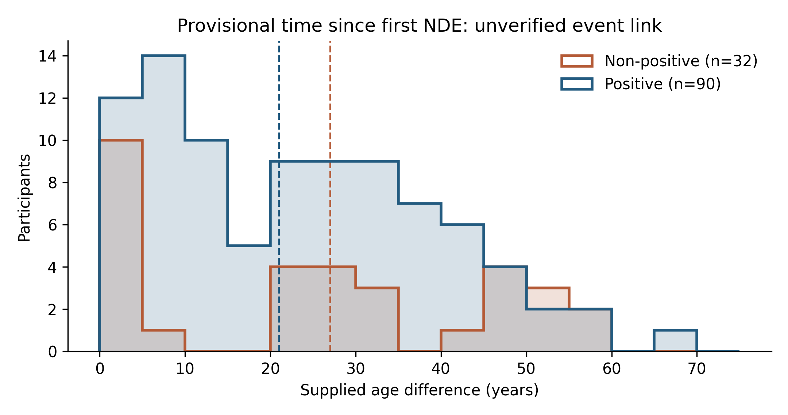
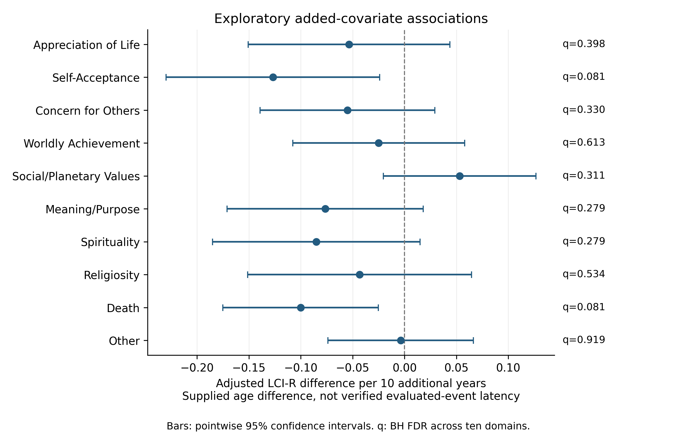
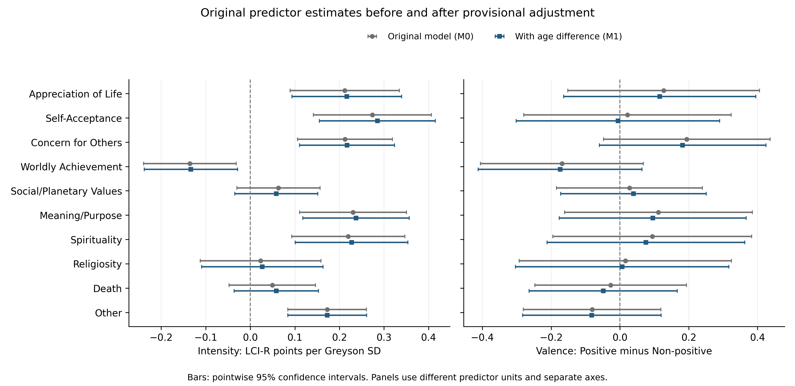

# Exploratory adjustment for time since the first NDE: an unverified age-difference measure

## 1. Research question

Reviewer 2 asked whether time since the near-death experience (NDE) should be included as a covariate. We investigated whether an age difference explains additional life changes or alters associations with intensity and valence. This exploration cannot establish definitive adjustment for time since the evaluated experience.

## 2. Data and feasibility

All 122 participants matched uniquely to the age file, with no missing ages. Supplied current ages ranged from 22 to 94 and first-NDE ages from 10 to 79. There were no negative ages, ages above 100, or cases where first-NDE age exceeded current age.

We subtracted supplied first-NDE age from supplied current age. These definitions cannot be verified. The measure is therefore a **provisional estimate of time since the first NDE**, not verified time since the evaluated NDE. No NDE count, selection rule or evaluated-event date was available; multiple-NDE participants could not be identified.

The difference averaged 23.25 years (SD 16.93), with median 23, interquartile range 8–36, and range 0–66. Five zero differences were retained; whole-year ages cannot resolve timing within a year. Means were 22.51 years in Positive (n=90) and 25.31 in Non-positive experiences (n=32).

**Figure 1. Distribution.** Bars count participants; colours identify valence groups and dashed lines their medians. The measure does not verify event dates.

## 3. Methods

For ten Life Changes Inventory–Revised (LCI-R) domains, including exploratory Other, original and expanded linear models used the same 122 participants. LCI-R scores range from −2 (strongly diminished) to +2 (strongly increased). Both models retained intensity, valence, first-NDE age, sex, education, prior diagnosis, Childhood Trauma Questionnaire minimization/denial score and death context. Current age was not additionally included: it equals first-NDE age plus the difference. Benjamini–Hochberg false discovery rate (FDR) correction covered ten added-covariate tests, using q<0.05.

## 4. Main results

Coefficients express the adjusted LCI-R score difference per ten additional years; intervals are pointwise 95% confidence intervals. ΔR² measures the increase in explained variance.

| LCI-R domain | β per 10 years | 95% CI | p | FDR q | ΔR² |
| --- | --- | --- | --- | --- | --- |
| Appreciation of Life | -0.0534 | [-0.1507, 0.0438] | 0.2785 | 0.3978 | 0.0080 |
| Self-Acceptance | -0.1268 | [-0.2297, -0.0239] | 0.0162 | 0.0808 | 0.0401 |
| Concern for Others | -0.0551 | [-0.1393, 0.0292] | 0.1981 | 0.3301 | 0.0112 |
| Worldly Achievement | -0.0250 | [-0.1078, 0.0579] | 0.5518 | 0.6131 | 0.0026 |
| Social/Planetary Values | 0.0531 | [-0.0205, 0.1267] | 0.1555 | 0.3109 | 0.0167 |
| Meaning/Purpose | -0.0765 | [-0.1710, 0.0180] | 0.1117 | 0.2792 | 0.0165 |
| Spirituality | -0.0851 | [-0.1851, 0.0149] | 0.0947 | 0.2792 | 0.0193 |
| Religiosity | -0.0434 | [-0.1512, 0.0645] | 0.4271 | 0.5339 | 0.0050 |
| Death | -0.1002 | [-0.1751, -0.0252] | 0.0093 | 0.0808 | 0.0566 |
| Other | -0.0036 | [-0.0737, 0.0665] | 0.9185 | 0.9185 | 0.0001 |

No association survived FDR correction. Self-Acceptance and Death showed nominal negative associations, with larger differences associated with lower reported-change scores. Their added explained variance was 4.01 and 5.66 percentage points, respectively. HC3 robust standard errors also yielded no FDR-significant result (q=0.0648 and 0.1462, respectively).

**Figure 2. Added-covariate estimates.** Dots show estimates and bars their uncertainty. Bars crossing zero permit either direction; intervals excluding zero indicate nominal evidence only. The q-values account for testing ten domains.

## 5. Interpretation

Intensity retained its direction in every domain and met the same domain-specific FDR threshold in 7 domains before and 7 after adjustment. Valence met that threshold in 0 domains after adjustment. This preserves the broad original pattern without independently confirming the manuscript’s comparison of predictor importance. Nonsignificance does not establish absence of association.

**Figure 3. Changes in the original predictors.** Paired estimates compare the original and expanded models. Panels use different predictor units; their coefficient magnitudes should not be directly compared.

## 6. Limitations

Unknown event selection and multiple-NDE status prevent validating the temporal interpretation. Whole-year ages limit precision. Holding first-NDE age constant, larger differences also imply older current age; duration and ageing cannot be separated. Substituting current age for first-NDE age reproduced predictions: mathematical equivalence, not independent validation. ΔR² reflects within-sample fit, not validated prediction. Cross-sectional associations do not establish causality.