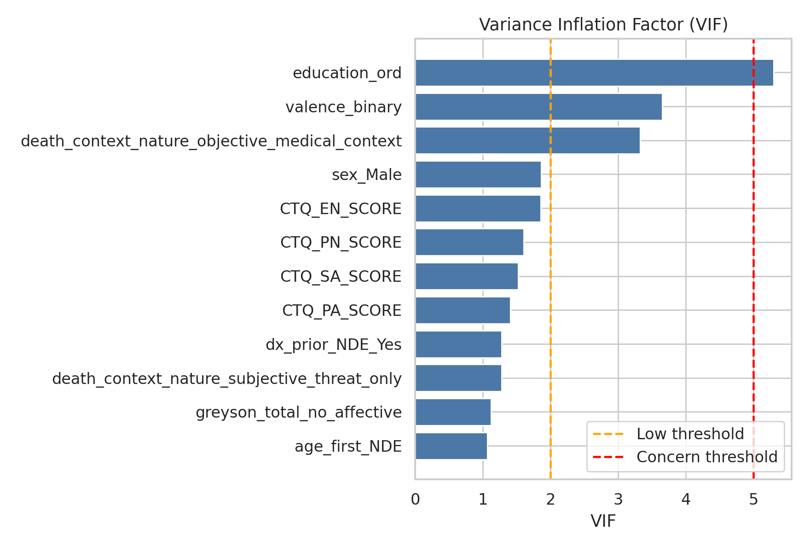
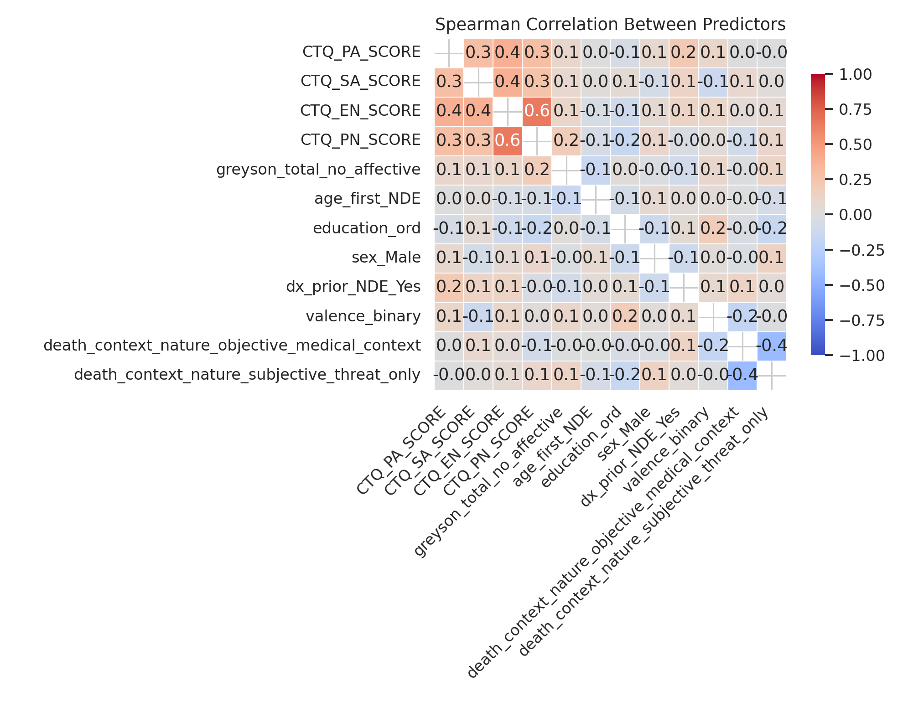
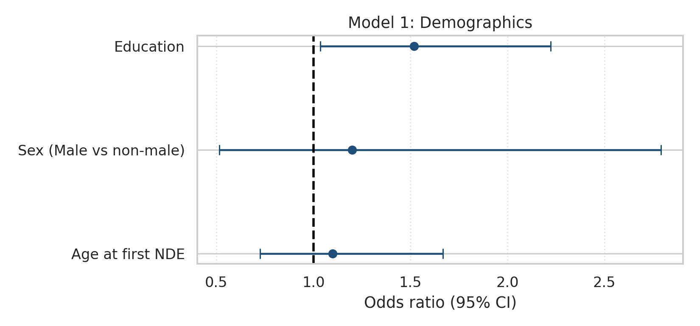
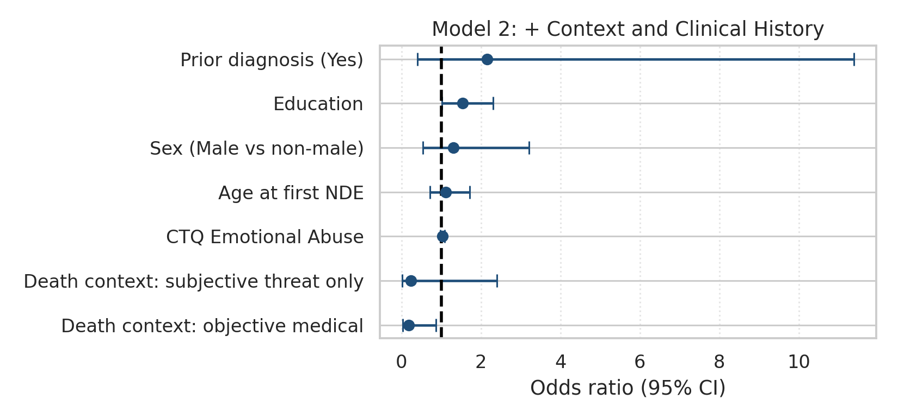
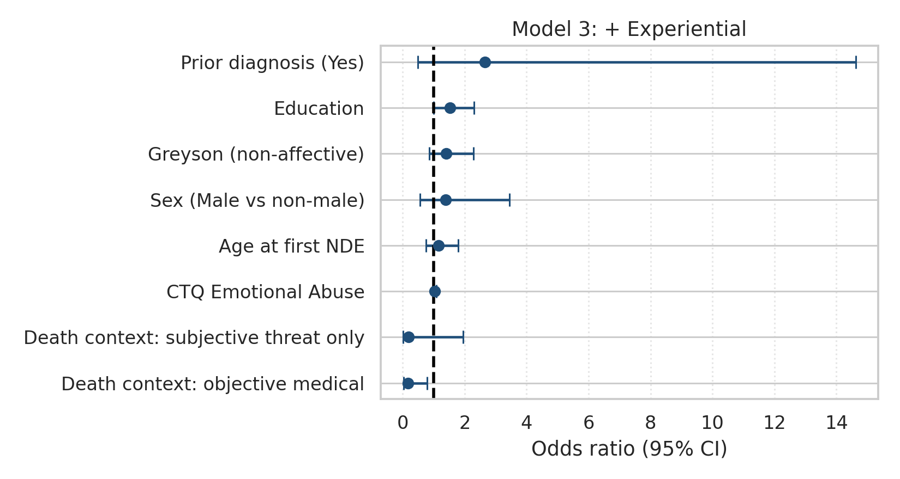
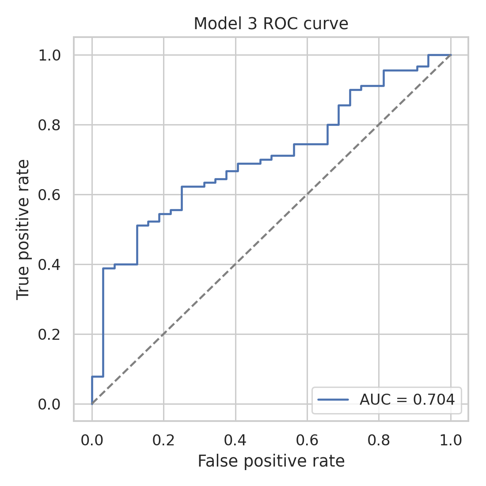
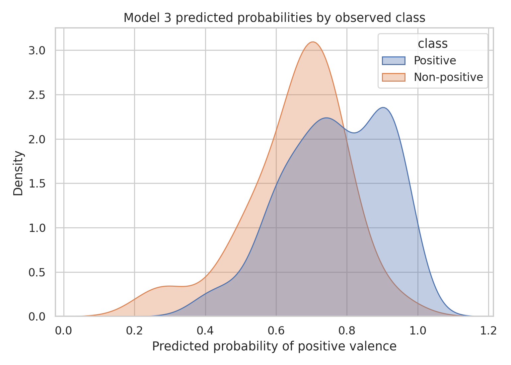

# Valence Multivariate Modeling Report

## Research Question

Do demographic, clinical-history, context, and experiential variables independently predict NDE valence?

## Valence Class Distribution

Original valence distribution:

```
 valence  n    pct
Positive 90 73.770
   Mixed 28 22.951
Negative  4  3.279
```

Binarized valence distribution used for modeling:

```
                 valence_binary  n   pct
                       Positive 90 73.77
Non-positive (Mixed + Negative) 32 26.23
```

Mixed and Negative categories are grouped into a single non-positive class to ensure adequate group size and stable estimation in multivariate models.

## Methodology

- Outcome: binary valence (`Positive = 1`, `Mixed/Negative = 0`).
- Models: hierarchical logistic regression.
  - Model 1: demographics only.
  - Model 2: demographics + diagnosis history + death-context structure.
  - Model 3: Model 2 + experiential factor.
- Missing data handling: complete-case per model.
- Fit diagnostics: pseudo-R² and likelihood-ratio tests.
- Multiple-testing control: Benjamini-Hochberg FDR correction for predictor-level and model-comparison p-values.

## Model Sample Sizes

```
  model   n  pseudo_r2
Model 1 122      0.034
Model 2 122      0.095
Model 3 122      0.109
```

## Likelihood-Ratio Comparisons

```
        comparison  lr_stat  df_diff  p_value  p_value_fdr p_value_fdr_reject
Model 2 vs Model 1    8.450      4.0    0.076        0.153                 No
Model 3 vs Model 2    1.973      1.0    0.160        0.160                 No
```

## Multicollinearity Diagnostics (VIF)

VIF is computed using valence, demographic variables, CTQ subscales, diagnosis status, death-context dummies, and Greyson non-affective score.

```
                                     predictor   vif collinearity
                                 education_ord 5.305         High
                                valence_binary 3.654     Moderate
death_context_nature_objective_medical_context 3.330     Moderate
                                      sex_Male 1.865          Low
                                  CTQ_EN_SCORE 1.859          Low
                                  CTQ_PN_SCORE 1.606          Low
                                  CTQ_SA_SCORE 1.520          Low
                                  CTQ_PA_SCORE 1.409          Low
                              dx_prior_NDE_Yes 1.278          Low
   death_context_nature_subjective_threat_only 1.277          Low
                    greyson_total_no_affective 1.121          Low
                                 age_first_NDE 1.067          Low
```



## Predictor Correlation Heatmap

Spearman correlations among predictors are shown below to visualize dependence structure.



## Coefficients (Odds Ratios)

### Model 1

```
             predictor  coef    or  ci_low  ci_high  p_value  p_value_fdr p_value_fdr_reject
      Age at first NDE 0.095 1.100   0.725    1.668    0.654        0.672                 No
             Education 0.417 1.518   1.036    2.224    0.032        0.097                 No
Sex (Male vs non-male) 0.183 1.200   0.516    2.792    0.672        0.672                 No
```

### Model 2

```
                            predictor   coef    or  ci_low  ci_high  p_value  p_value_fdr p_value_fdr_reject
                     Age at first NDE  0.104 1.109   0.719    1.712    0.639        0.639                 No
                            Education  0.429 1.536   1.022    2.310    0.039        0.137                 No
               Sex (Male vs non-male)  0.273 1.314   0.537    3.213    0.550        0.639                 No
                  CTQ Emotional Abuse  0.033 1.034   0.979    1.092    0.236        0.413                 No
                Prior diagnosis (Yes)  0.770 2.159   0.409   11.385    0.364        0.510                 No
     Death context: objective medical -1.700 0.183   0.039    0.864    0.032        0.137                 No
Death context: subjective threat only -1.419 0.242   0.024    2.401    0.226        0.413                 No
```

### Model 3

```
                            predictor   coef    or  ci_low  ci_high  p_value  p_value_fdr p_value_fdr_reject
                     Age at first NDE  0.143 1.154   0.745    1.789    0.521        0.521                 No
                            Education  0.418 1.519   1.005    2.297    0.047        0.190                 No
               Sex (Male vs non-male)  0.328 1.388   0.558    3.452    0.481        0.521                 No
                  CTQ Emotional Abuse  0.028 1.028   0.972    1.087    0.333        0.444                 No
                Prior diagnosis (Yes)  0.977 2.656   0.482   14.630    0.262        0.419                 No
     Death context: objective medical -1.816 0.163   0.033    0.790    0.024        0.190                 No
Death context: subjective threat only -1.690 0.185   0.018    1.942    0.159        0.344                 No
              Greyson (non-affective)  0.338 1.403   0.863    2.279    0.172        0.344                 No
```

## Figures

### Model 1 Odds-Ratio Forest



### Model 2 Odds-Ratio Forest



### Model 3 Odds-Ratio Forest



### Model 3 ROC



### Model 3 Predicted Probabilities



## Interpretation

Model fit improved from pseudo-R²=0.034 (demographics only) to pseudo-R²=0.109 (full model). LR tests indicated FDR-adjusted p=0.153 for Model 2 vs 1 and p=0.160 for Model 3 vs 2. Model 3 ROC AUC=0.704.

## Limitations

- Complete-case analysis can reduce effective sample size.
- Logistic model estimates are association-based and do not imply causality.