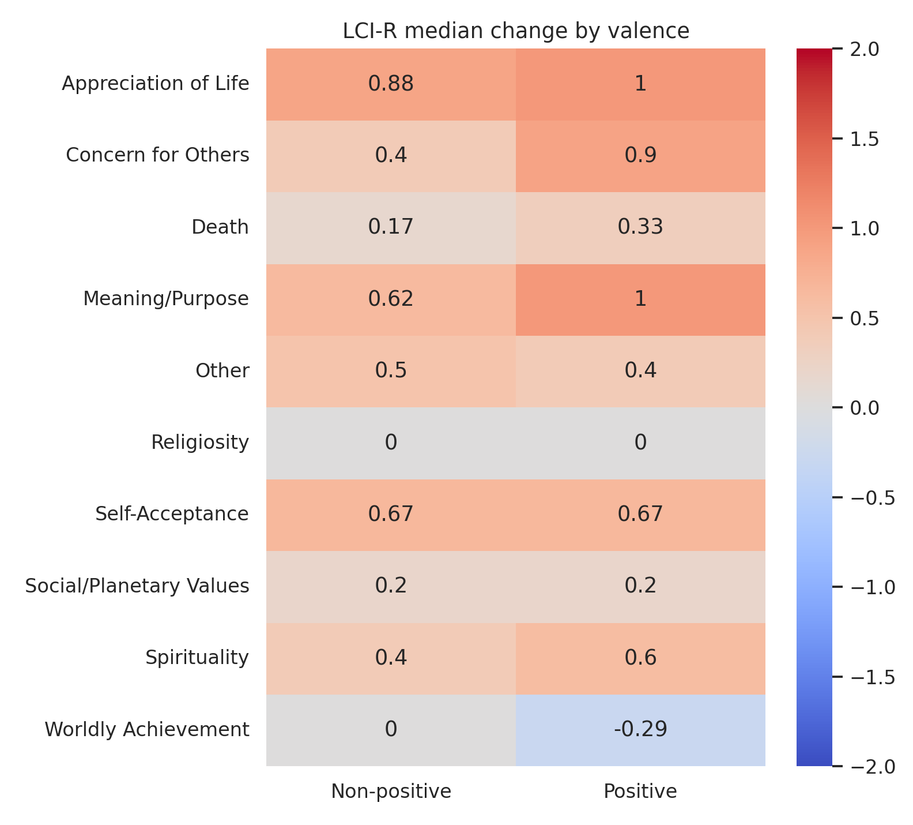
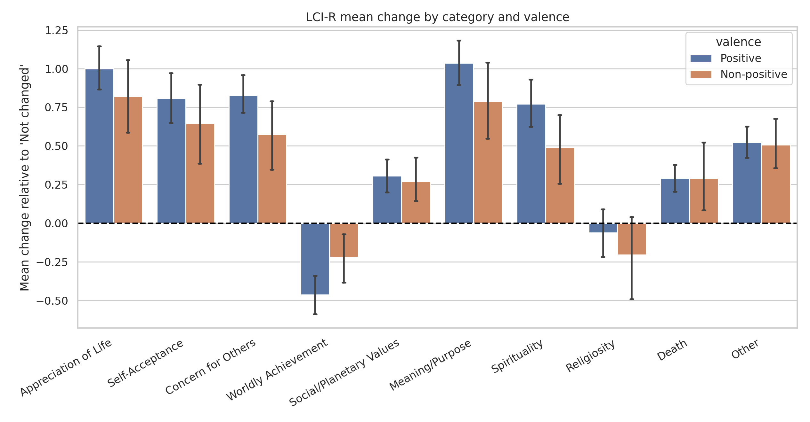
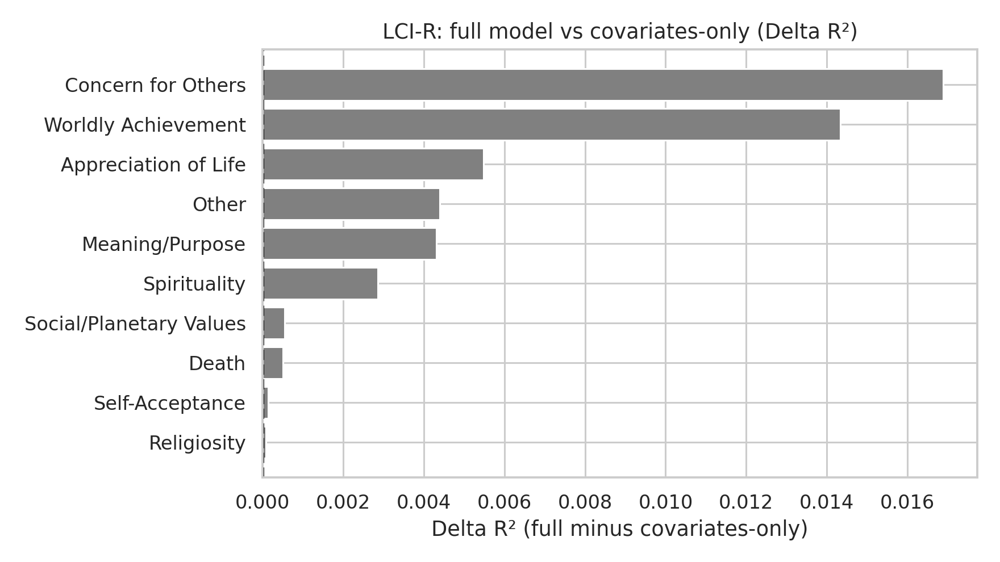
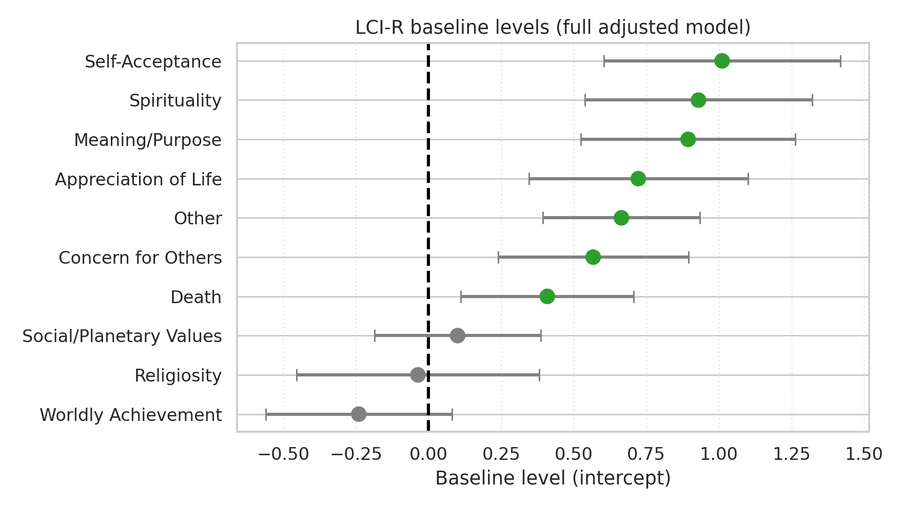
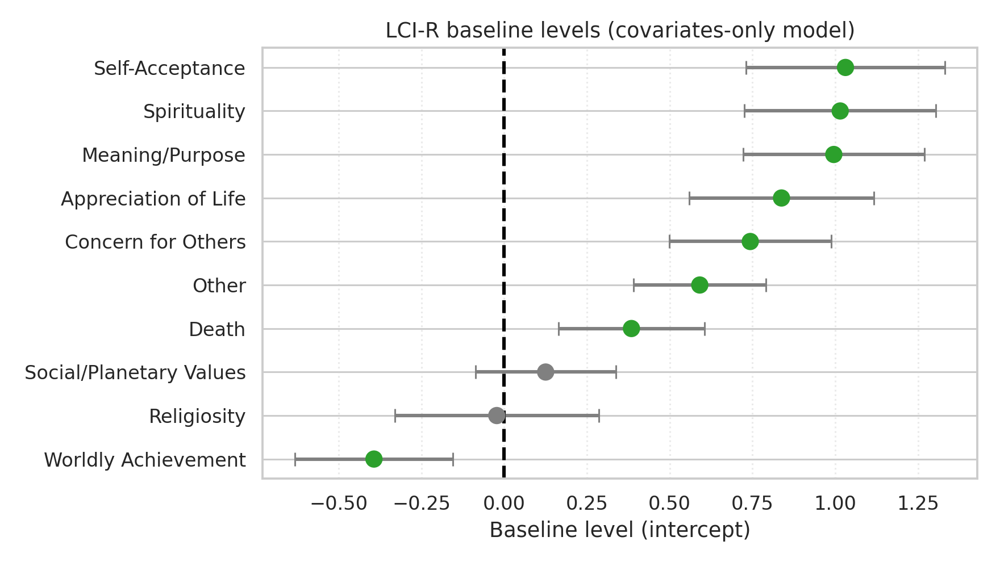

# Post-NDE Effects Report

## Scope

This report summarizes post-NDE effects for LCI-R.

## Methodology

- Global change versus zero: Wilcoxon signed-rank test.
- Positive vs non-positive valence comparison: Mann-Whitney U test.
- Multiple-testing control: Benjamini-Hochberg FDR correction within each hypothesis family.
- Adjusted OLS models:
  - Full model: `outcome ~ valence + covariates`
  - Covariates-only model: `outcome ~ covariates`
- Model comparison: R², AIC, BIC, and delta metrics.

## Global Change

```
               category  median   mean  p_value   n  p_value_fdr p_value_fdr_reject
     Concern for Others   0.800  0.761    0.000 122        0.000                Yes
        Meaning/Purpose   1.000  0.971    0.000 122        0.000                Yes
   Appreciation of Life   1.000  0.953    0.000 122        0.000                Yes
                  Other   0.400  0.520    0.000 122        0.000                Yes
        Self-Acceptance   0.667  0.765    0.000 122        0.000                Yes
           Spirituality   0.600  0.697    0.000 122        0.000                Yes
    Worldly Achievement  -0.143 -0.398    0.000 122        0.000                Yes
Social/Planetary Values   0.200  0.297    0.000 122        0.000                Yes
                  Death   0.333  0.292    0.000 122        0.000                Yes
            Religiosity   0.000 -0.098    0.261 122        0.261                 No
```

## Differences by Valence

```
               category  mean_positive  mean_non_positive  median_positive  median_non_positive  p_value  n_positive  n_non_positive  p_value_fdr p_value_fdr_reject
    Worldly Achievement         -0.462             -0.219           -0.286                0.000    0.053          90              32        0.164                 No
     Concern for Others          0.828              0.575            0.900                0.400    0.052          90              32        0.164                 No
           Spirituality          0.771              0.488            0.600                0.400    0.046          90              32        0.164                 No
        Meaning/Purpose          1.036              0.789            1.000                0.625    0.065          90              32        0.164                 No
   Appreciation of Life          1.000              0.820            1.000                0.875    0.252          90              32        0.504                 No
        Self-Acceptance          0.807              0.646            0.667                0.667    0.393          90              32        0.560                 No
            Religiosity         -0.061             -0.203            0.000                0.000    0.448          90              32        0.560                 No
                  Death          0.293              0.292            0.333                0.167    0.377          90              32        0.560                 No
Social/Planetary Values          0.307              0.269            0.200                0.200    0.792          90              32        0.880                 No
                  Other          0.524              0.506            0.400                0.500    0.958          90              32        0.958                 No
```

## Adjusted Models (Full)

```
                outcome   N  baseline  baseline_ci_low  baseline_ci_high  baseline_p  baseline_p_fdr  valence_beta  valence_ci_low  valence_ci_high  valence_p  valence_p_fdr    r2     aic     bic
    Worldly Achievement 122    -0.240           -0.560             0.080       0.140           0.175        -0.169          -0.405            0.068      0.161          0.806 0.193 208.828 236.868
     Concern for Others 122     0.567            0.240             0.895       0.001           0.001         0.194          -0.048            0.436      0.115          0.806 0.250 214.377 242.417
   Appreciation of Life 122     0.722            0.345             1.100       0.000           0.000         0.127          -0.152            0.406      0.369          0.849 0.246 248.847 276.887
        Meaning/Purpose 122     0.894            0.525             1.263       0.000           0.000         0.112          -0.161            0.385      0.418          0.849 0.269 243.448 271.488
                  Other 122     0.665            0.394             0.935       0.000           0.000        -0.081          -0.281            0.119      0.424          0.849 0.233 167.761 195.801
           Spirituality 122     0.930            0.539             1.321       0.000           0.000         0.094          -0.195            0.383      0.521          0.868 0.226 257.490 285.530
Social/Planetary Values 122     0.100           -0.186             0.387       0.490           0.544         0.028          -0.184            0.240      0.796          0.920 0.079 181.805 209.845
        Self-Acceptance 122     1.011            0.604             1.419       0.000           0.000         0.022          -0.280            0.323      0.887          0.920 0.215 267.694 295.734
            Religiosity 122    -0.036           -0.454             0.381       0.863           0.863         0.016          -0.293            0.324      0.920          0.920 0.121 273.514 301.554
                  Death 122     0.409            0.111             0.707       0.008           0.011        -0.027          -0.248            0.193      0.808          0.920 0.048 191.429 219.469
```

## Adjusted Models (Covariates-Only)

```
                outcome   N  baseline  baseline_ci_low  baseline_ci_high  baseline_p  baseline_p_fdr    r2     aic     bic
   Appreciation of Life 122     0.838            0.559             1.117       0.000           0.000 0.240 247.731 272.967
     Concern for Others 122     0.744            0.499             0.988       0.000           0.000 0.233 215.093 240.329
                  Death 122     0.385            0.165             0.605       0.001           0.001 0.047 189.493 214.729
        Meaning/Purpose 122     0.996            0.723             1.269       0.000           0.000 0.265 242.165 267.401
                  Other 122     0.591            0.391             0.791       0.000           0.000 0.228 166.459 191.695
            Religiosity 122    -0.022           -0.330             0.286       0.886           0.886 0.121 271.524 296.761
        Self-Acceptance 122     1.031            0.730             1.332       0.000           0.000 0.214 265.716 290.952
Social/Planetary Values 122     0.125           -0.086             0.337       0.243           0.270 0.079 179.878 205.114
           Spirituality 122     1.015            0.726             1.304       0.000           0.000 0.223 255.941 281.177
    Worldly Achievement 122    -0.393           -0.632            -0.155       0.001           0.002 0.178 208.976 234.212
```

## Full vs Covariates-Only Comparison

```
                outcome   N  valence_beta  valence_ci_low  valence_ci_high  valence_p  valence_p_fdr valence_fdr_reject  R2_full  R2_cov_only  delta_R2  delta_AIC  delta_BIC valence_adds_signal
    Worldly Achievement 122        -0.169          -0.405            0.068      0.161          0.806                 No    0.193        0.178     0.014     -0.148      2.656                  No
     Concern for Others 122         0.194          -0.048            0.436      0.115          0.806                 No    0.250        0.233     0.017     -0.716      2.088                  No
   Appreciation of Life 122         0.127          -0.152            0.406      0.369          0.849                 No    0.246        0.240     0.005      1.116      3.920                  No
        Meaning/Purpose 122         0.112          -0.161            0.385      0.418          0.849                 No    0.269        0.265     0.004      1.283      4.087                  No
                  Other 122        -0.081          -0.281            0.119      0.424          0.849                 No    0.233        0.228     0.004      1.302      4.106                  No
           Spirituality 122         0.094          -0.195            0.383      0.521          0.868                 No    0.226        0.223     0.003      1.549      4.353                  No
Social/Planetary Values 122         0.028          -0.184            0.240      0.796          0.920                 No    0.079        0.079     0.001      1.927      4.731                  No
        Self-Acceptance 122         0.022          -0.280            0.323      0.887          0.920                 No    0.215        0.214     0.000      1.978      4.782                  No
            Religiosity 122         0.016          -0.293            0.324      0.920          0.920                 No    0.121        0.121     0.000      1.989      4.793                  No
                  Death 122        -0.027          -0.248            0.193      0.808          0.920                 No    0.048        0.047     0.001      1.936      4.740                  No
```

## Figures













## Interpretation

0 outcomes showed evidence that valence adds explanatory value beyond covariates after FDR correction. Interpretation is based on FDR-adjusted valence p-values in the full model and model-fit deltas between full and covariates-only specifications.