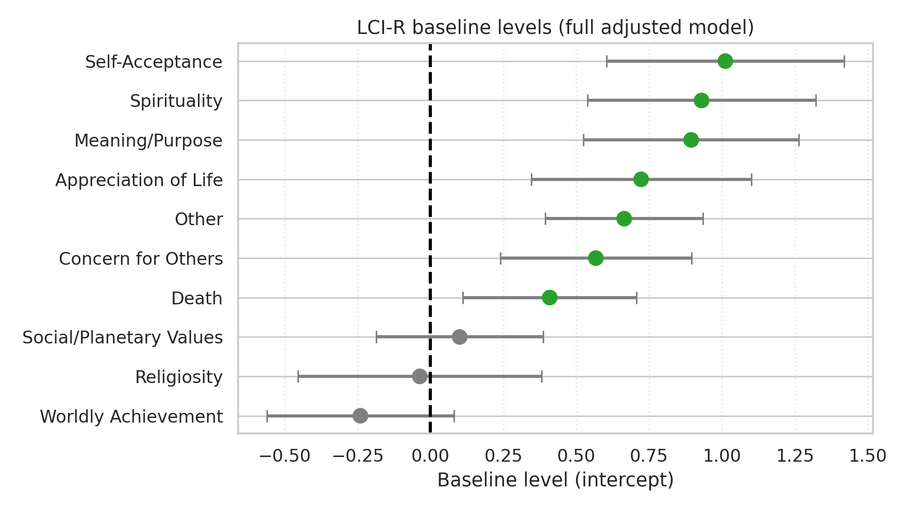
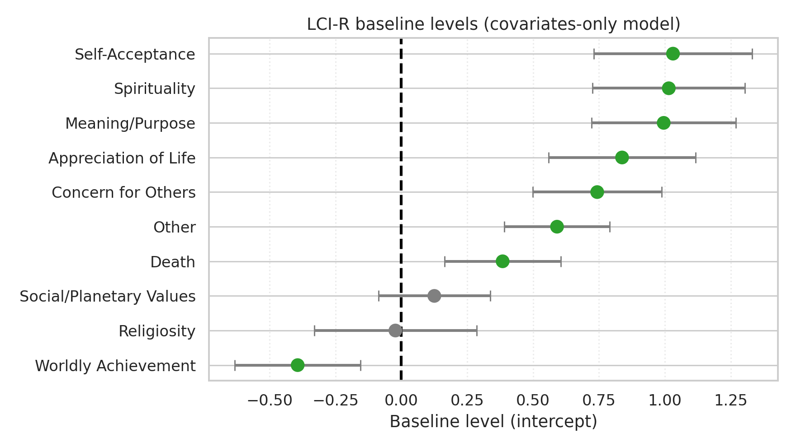

# Adjusted Models Comparison

## LCI-R: Full vs Covariates-Only

```
                outcome   N  valence_beta  valence_ci_low  valence_ci_high  valence_p  valence_p_fdr valence_fdr_reject  R2_full  R2_cov_only  delta_R2  delta_AIC  delta_BIC valence_adds_signal
    Worldly Achievement 122        -0.169          -0.405            0.068      0.161          0.806                 No    0.193        0.178     0.014     -0.148      2.656                  No
     Concern for Others 122         0.194          -0.048            0.436      0.115          0.806                 No    0.250        0.233     0.017     -0.716      2.088                  No
   Appreciation of Life 122         0.127          -0.152            0.406      0.369          0.849                 No    0.246        0.240     0.005      1.116      3.920                  No
        Meaning/Purpose 122         0.112          -0.161            0.385      0.418          0.849                 No    0.269        0.265     0.004      1.283      4.087                  No
                  Other 122        -0.081          -0.281            0.119      0.424          0.849                 No    0.233        0.228     0.004      1.302      4.106                  No
           Spirituality 122         0.094          -0.195            0.383      0.521          0.868                 No    0.226        0.223     0.003      1.549      4.353                  No
Social/Planetary Values 122         0.028          -0.184            0.240      0.796          0.920                 No    0.079        0.079     0.001      1.927      4.731                  No
        Self-Acceptance 122         0.022          -0.280            0.323      0.887          0.920                 No    0.215        0.214     0.000      1.978      4.782                  No
            Religiosity 122         0.016          -0.293            0.324      0.920          0.920                 No    0.121        0.121     0.000      1.989      4.793                  No
                  Death 122        -0.027          -0.248            0.193      0.808          0.920                 No    0.048        0.047     0.001      1.936      4.740                  No
```





