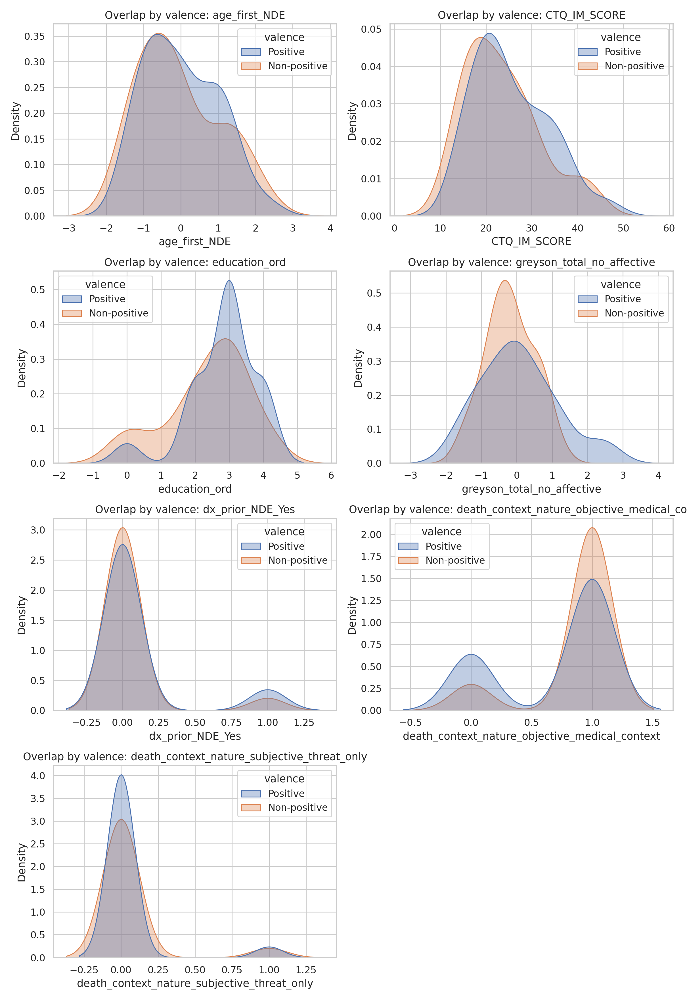
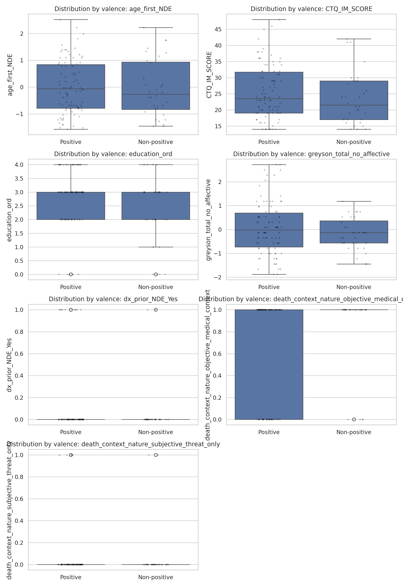
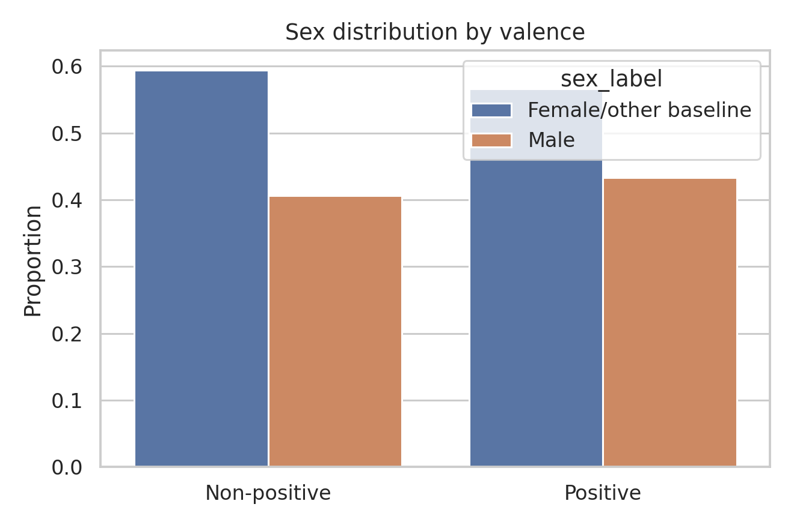

# Covariate Diagnostics Report

## Purpose

Evaluate covariate overlap and group balance between positive and non-positive valence groups before adjusted outcome modeling.

## Methodology

- Continuous and ordinal covariates: Mann-Whitney U tests.
- Categorical covariate (`sex_Male`): chi-square test.
- Analysis sample: available-case per variable (N varies by covariate and by valence group for descriptive summaries and non-parametric balance tests).
- Multiple-testing control: Benjamini-Hochberg FDR correction across balance tests.
- Visual diagnostics:
  - KDE overlap by valence
  - box/strip distributions by valence
  - sex distribution bar chart

## Overall Descriptive Statistics (Pre-Transformation)

```
                                      variable   n   mean    std
                                 age_first_NDE 122 36.557 16.921
                                  CTQ_IM_SCORE 122 24.984  8.200
                                 education_ord 122  2.713  1.040
                    greyson_total_no_affective 122 10.590  4.585
                              dx_prior_NDE_Yes 122  0.098  0.299
death_context_nature_objective_medical_context 122  0.746  0.437
   death_context_nature_subjective_threat_only 122  0.057  0.234
```

### Categorical Variable Summary

```
variable          top_category  top_pct   n
sex_Male Female/other baseline   57.377 122
```

## Descriptive Summary by Valence

```
                                      variable      valence  count   mean   std  median    min    max
                                 age_first_NDE Non-positive     32 -0.053 1.069  -0.270 -1.457  2.222
                                 age_first_NDE     Positive     90  0.019 0.986  -0.063 -1.576  2.519
                                  CTQ_IM_SCORE Non-positive     32 23.562 8.084  21.500 14.000 42.000
                                  CTQ_IM_SCORE     Positive     90 25.489 8.226  23.500 14.000 48.000
                                 education_ord Non-positive     32  2.375 1.185   3.000  0.000  4.000
                                 education_ord     Positive     90  2.833 0.963   3.000  0.000  4.000
                    greyson_total_no_affective Non-positive     32 -0.184 0.674  -0.129 -1.443  1.185
                    greyson_total_no_affective     Positive     90  0.065 1.094  -0.020 -1.881  2.718
                              dx_prior_NDE_Yes Non-positive     32  0.062 0.246   0.000  0.000  1.000
                              dx_prior_NDE_Yes     Positive     90  0.111 0.316   0.000  0.000  1.000
death_context_nature_objective_medical_context Non-positive     32  0.875 0.336   1.000  0.000  1.000
death_context_nature_objective_medical_context     Positive     90  0.700 0.461   1.000  0.000  1.000
   death_context_nature_subjective_threat_only Non-positive     32  0.062 0.246   0.000  0.000  1.000
   death_context_nature_subjective_threat_only     Positive     90  0.056 0.230   0.000  0.000  1.000
```

## Balance Tests

```
                                      variable               type  p_value  mean_positive  mean_non_positive  p_value_fdr p_value_fdr_reject
                                 education_ord continuous/ordinal    0.049          2.833              2.375        0.209                 No
death_context_nature_objective_medical_context continuous/ordinal    0.052          0.700              0.875        0.209                 No
                                  CTQ_IM_SCORE continuous/ordinal    0.229         25.489             23.562        0.610                 No
                    greyson_total_no_affective continuous/ordinal    0.336          0.065             -0.184        0.671                 No
                              dx_prior_NDE_Yes continuous/ordinal    0.433          0.111              0.062        0.693                 No
                                 age_first_NDE continuous/ordinal    0.671          0.019             -0.053        0.894                 No
   death_context_nature_subjective_threat_only continuous/ordinal    0.891          0.056              0.062        0.954                 No
                                      sex_Male        categorical    0.954          0.433              0.406        0.954                 No
```

## Figures







## Interpretation

0 covariates were imbalanced at FDR-adjusted p<0.05 and 0 at FDR-adjusted p<0.10. Distribution overlap plots and balance tests jointly support whether adjusted analysis is plausible.